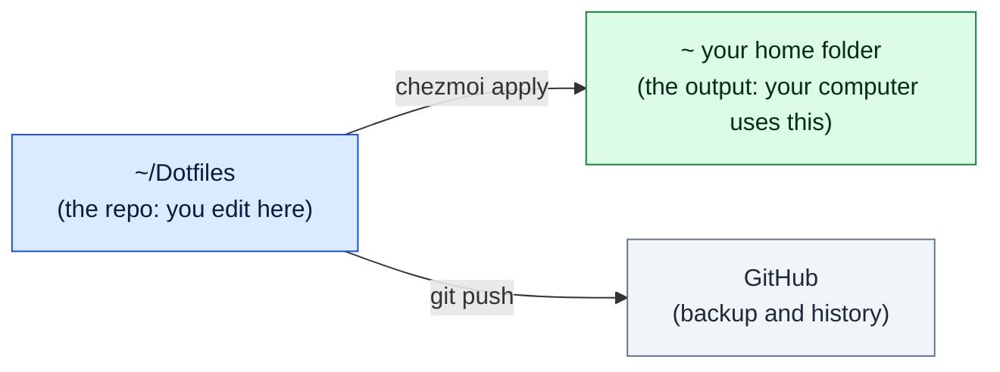
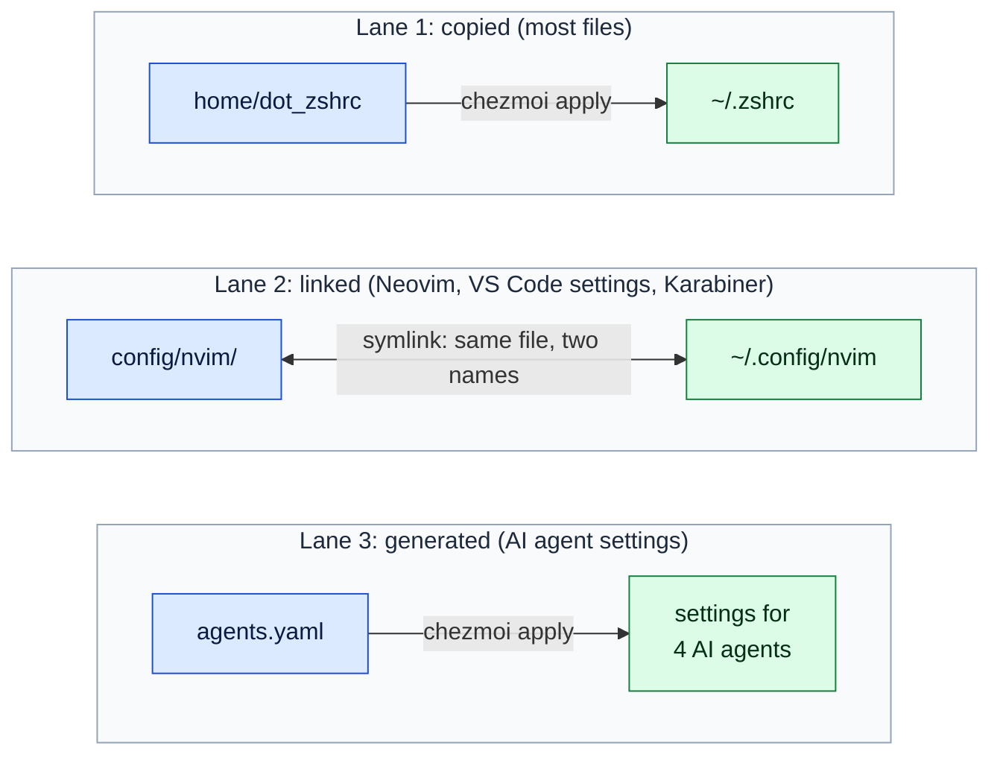
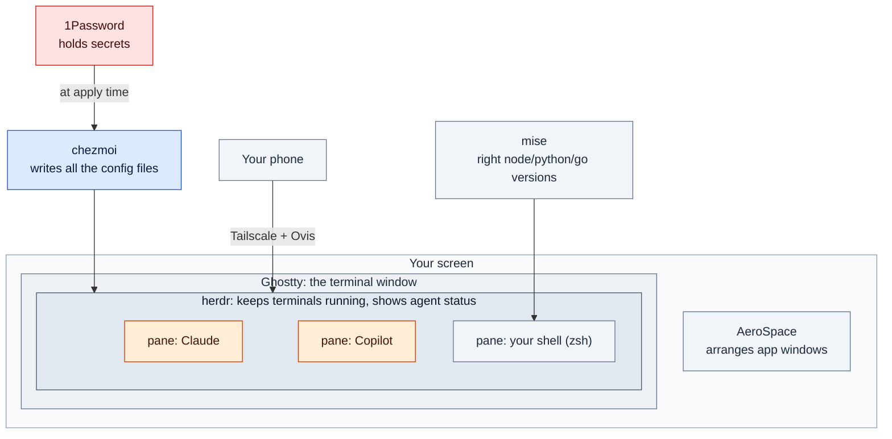

# 1. The big picture

[← Start here](README.md) · Next: [chezmoi basics →](02-chezmoi-basics.md)

This chapter has no commands to learn. It gives you a map, so the other chapters have somewhere to fit.

## The one idea

If you remember one thing from these docs, make it this:

> **Before**, `~/.zshrc` *was* your config. You edited it, opened a new shell, done.
>
> **Now**, the folder `~/Dotfiles` is your config, and the files in your home folder are its **output**. A program called **chezmoi** turns one into the other.

Two words you'll see everywhere:

- **Home folder** (written `~`): your personal folder: `/Users/youngjaelim` on the M2, `/home/youngjae-lim` on the Ubuntu spares. `~/.zshrc` means "the file `.zshrc` in my home folder".
- **Repository** (or **repo**): a folder whose history is tracked by **git**. `~/Dotfiles` is a repo, and a copy of it lives on GitHub.



Notice the two arrows are separate. `chezmoi apply` makes the computer you run it on **use** a change. `git push` **saves** it on GitHub. Neither one does the other's job. [Chapter 2](02-chezmoi-basics.md) covers both.

## Your computers

The same repo sets up more than one computer:

| Called here | What it is | Gets |
|---|---|---|
| **The M2** | Your M2 MacBook Pro, on macOS: the main computer | Everything. It's where you change the dotfiles |
| **The Mac Pro**, **the Mac mini** | Old Macs running Ubuntu: **the Ubuntu spares** | The shared part: shell, Neovim, mise, herdr, agents ([chapter 14](14-spare-linux.md)) |

Most chapters describe the M2. Where something differs on the spares, the chapter says so. Chapter 9 (windows and keys) is about the M2 only.

## Three ways a file gets to your home folder

Every file in the repo reaches your home folder in one of three ways. We call them **lanes**. Once you know which lane a file is in, you know how to change it.



| Lane | Which files | How you change them |
|---|---|---|
| **1. Copied** | zsh, git, tmux, Ghostty, herdr, AeroSpace, mise, your scripts | Edit in `~/Dotfiles/home/`, then run `chezmoi apply`. **Editing `~/.zshrc` directly doesn't stick**: the next apply overwrites it. |
| **2. Linked** | Neovim, VS Code settings and keys, Karabiner | **Exactly like before.** Edit, save, done. No apply. |
| **3. Generated** | Settings for Claude, Copilot, Gemini and VS Code's AI tools | Edit one file (`agents.yaml`), run `scripts/check.sh`, then `chezmoi apply`. Never edit the outputs. |

> **Symlink** (symbolic link): a file that points at another file, like a shortcut. Opening `~/.config/nvim` really opens `~/Dotfiles/config/nvim`. That's why lane 2 needs no apply: there's only one real file.

Lane 2 is good news: **your Neovim habits work unchanged.**

## The tools, and how they stack up

This setup has a lot of tools. Here's where each one sits. You don't need them all on day one.



The same picture in words, from the outside in:

1. **AeroSpace** arranges your app windows side by side automatically. ([Chapter 9](09-desktop.md))
2. **Ghostty** is the terminal app: the window where you type commands. ([Chapter 4](04-terminal.md))
3. **herdr** runs inside Ghostty. It's like tabs and splits that **keep running when you close the window**, and it shows whether each AI agent is busy, done, or waiting for you. ([Chapter 4](04-terminal.md))
4. **AI agents** (Claude Code, Copilot CLI, and Gemini CLI, which can't sign in with a personal account any more) run in herdr panes. They all read the **same** instructions and safety rules. ([Chapter 5](05-ai-agents.md))
5. **zsh** is your shell, the program that reads what you type. ([Chapter 4](04-terminal.md))
6. **mise** puts the right versions of node, python and go on your path. ([Chapter 8](08-languages-and-tools.md))
7. **chezmoi** writes all these tools' config files from `~/Dotfiles`. ([Chapters 2](02-chezmoi-basics.md) and [3](03-how-files-are-made.md))
8. **1Password** holds your secrets. chezmoi copies them into a private file when you apply, so they never go into git. ([Chapter 7](07-secrets.md))
9. **Tailscale + Ovis** let your phone see your agents and approve what they ask. ([Chapter 9](09-desktop.md))

## What's in the repo

```
~/Dotfiles/
├── home/          Lanes 1 and 3: what chezmoi copies or generates into ~
├── config/        Lane 2: configs that apps edit themselves (nvim, vscode, karabiner)
├── docs/          These docs
├── scripts/       check.sh (test everything), macos-defaults.sh (one-time setup)
├── Brewfile       Every app and tool to install with Homebrew (Mac-only ones inside `if OS.mac?`)
├── install.sh     Sets up a new computer: the M2, or an Ubuntu spare
├── AGENTS.md      Instructions for AI agents working in this repo
└── README.md      Short overview
```

> **Homebrew**: the standard way to install software on a Mac from the terminal (`brew install …`), and on the Ubuntu spares too, as Homebrew on Linux. The **Brewfile** is a list of everything to install; chezmoi runs it for you when it changes.

## What to learn now, and what can wait

| Learn now | When you need it | Safe to ignore for a long time |
|---|---|---|
| The three lanes | How `modify_` files merge settings | How the merge works inside |
| `chezmoi diff`, then `chezmoi apply` | Templates (`{{ … }}`) | Gemini's policy priorities |
| Where to edit zsh: `home/dot_config/zsh/` | `agents.yaml` | The hook and test scripts' internals |
| `scripts/check.sh` before committing | Secrets via 1Password | The CI workflow |

Next: [chezmoi basics →](02-chezmoi-basics.md)
