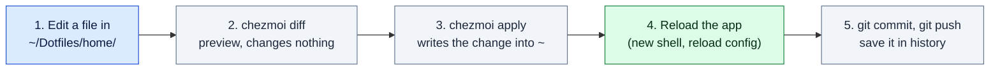
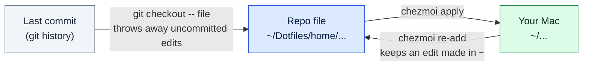
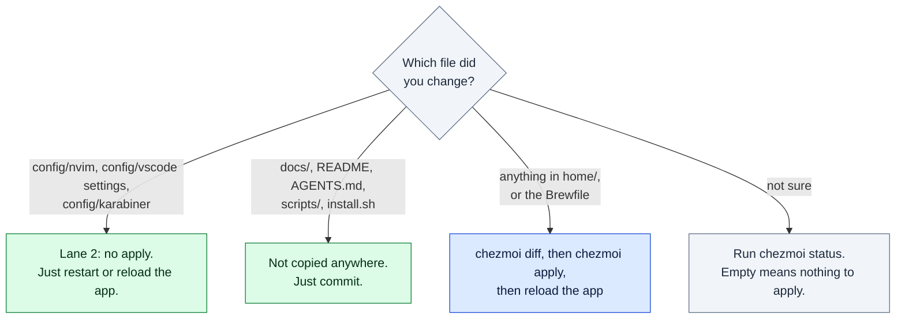
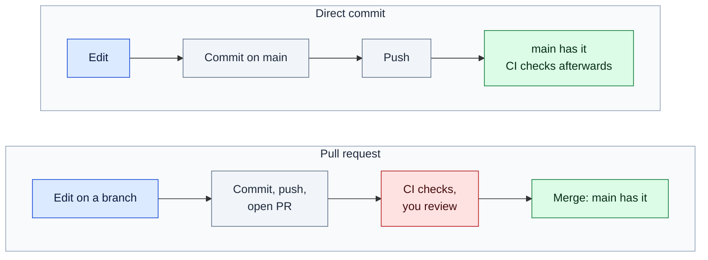
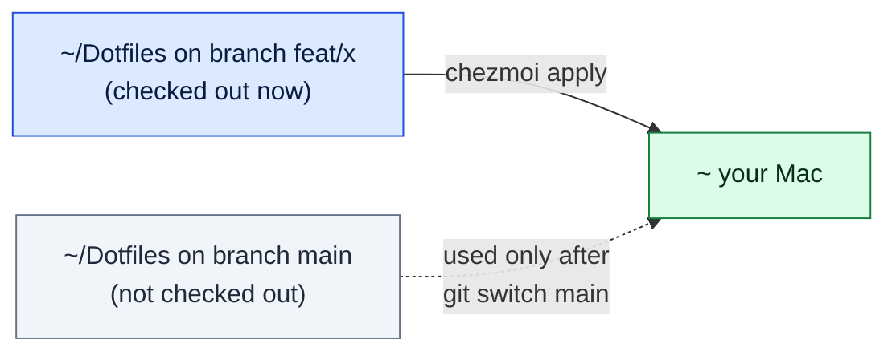
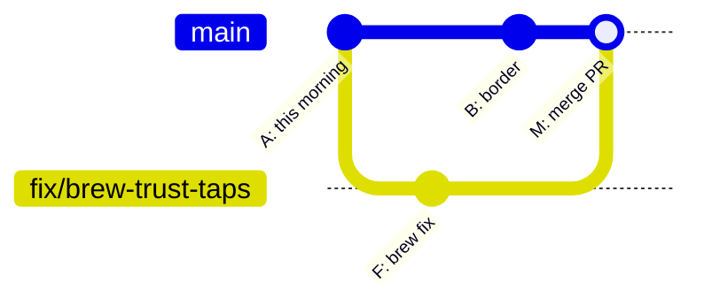

# 2. chezmoi basics

[← The big picture](01-big-picture.md) · Next: [How files are made →](03-how-files-are-made.md)

**What it is.** chezmoi (say "shay-mwah", French for "at my place") is a **dotfiles manager**. It reads the files in `~/Dotfiles`, which it calls the **source**, and writes them into your home folder, the **target**. Along the way it can fill in values (your email, a secret), make links, and run setup scripts.

**Why you have it.** One command sets up a new Mac. Secrets stay out of git. And one settings file can produce the configs for four different AI agents.

## The two commands that matter



- **`chezmoi diff`** shows exactly what *would* change in your home folder, and changes nothing. Always run it first.
- **`chezmoi apply`** makes your home folder match the repo. It only touches files that differ.

> **Diff**: a listing of the differences between two versions of a file. Lines starting with `-` would be removed, lines with `+` would be added.

### Reading `chezmoi diff`

**Direction:** a chezmoi diff runs from **what's in `~` now** to **what `apply` would make it**. So a line you added to the file in `~` by hand, but not to the repo, shows up as one that *would be removed*.

**Colours, not `+` and `-`:** your diffs go through **delta** ([chapter 8](08-languages-and-tools.md#small-tools-that-make-agents-better)), which marks changes with colour instead:

| Delta shows | Means | `apply` will… |
|---|---|---|
| **Red** line | in `~` now, not in the repo | remove it |
| **Green** line | in the repo, not in `~` yet | add it |
| Uncoloured line | the same in both | leave it alone |

The two columns of numbers on the left are line numbers: the old file's on the left, the new file's on the right. A changed line has a number on only one side.

### Three places, three commands

A file you manage with chezmoi can exist in three versions at once. Each command copies **one way** between two of them:



| Command | Copies from → to | Use it when |
|---|---|---|
| `chezmoi apply` | repo → `~` | You changed the repo and want your Mac to use it |
| `chezmoi re-add` | `~` → repo | You edited the copy in `~` by mistake and want to **keep** the edit |
| `git checkout -- <file>` | last commit → repo | You want to **throw away** uncommitted edits in the repo. It doesn't touch `~`: run `chezmoi apply` afterwards. |

**Committing is what makes a change safe.** Until you commit, `git checkout --` can wipe a change from the repo, and the next `apply` then removes it from your Mac too.

## Reading file names in `home/`

chezmoi uses **prefixes and endings** on file names as instructions. Strip them off and you get the real name.

| In the repo | Means | Example |
|---|---|---|
| `dot_` | becomes a leading `.` | `dot_zshrc` → `~/.zshrc` |
| `.tmpl` | a **template**: values get filled in ([chapter 3](03-how-files-are-made.md)) | `dot_config/git/config.tmpl` → `~/.config/git/config` |
| `private_` | only you can read it (file permission 600) | `private_secrets.zsh.tmpl` → `~/.config/zsh/secrets.zsh` |
| `executable_` | can be run as a program | `private_dot_local/bin/executable_notes` → `~/.local/bin/notes` |
| `symlink_` | lane 2: a link into `config/` | `dot_config/symlink_nvim.tmpl` → `~/.config/nvim` |
| `modify_` | updates part of a file that an app also writes ([chapter 3](03-how-files-are-made.md)) | `dot_claude/modify_settings.json.tmpl` |
| `.chezmoiscripts/run_onchange_…` | a script that re-runs when its input changes ([chapter 3](03-how-files-are-made.md)) | installs apps when the Brewfile changes |

Prefixes stack: `private_dot_local/bin/executable_notes` is "`.local`, private" then "`notes`, executable".

## Do I need to run `chezmoi apply`?

`chezmoi apply` and `git commit` are **separate**:

- **`chezmoi apply`** copies files from `~/Dotfiles` into your home folder, so your Mac *uses* the change.
- **`git commit`** and **`git push`** *save* the change in history and on GitHub.

> **Commit**: a saved snapshot of the repo, with a message saying what changed. **Push**: send your commits to GitHub.

Follow this to decide:



The same thing as a table:

| You changed… | Where it lives | Run `chezmoi apply`? | What makes it take effect |
|---|---|---|---|
| Neovim config or plugins (including `nvim-pack-lock.json`, `<leader>pu` updates) | `config/nvim/` | **No.** Live link. | Restart Neovim |
| VS Code `settings.json`, `keybindings.json` | `config/vscode/` | **No.** Live link. | Saves instantly, or reload the window |
| VS Code `mcp.json` | `agents.yaml` (`mcpServers`) | **Yes.** Generated. | Reload the window |
| Karabiner rules (changed in its app) | `config/karabiner/` | **No.** Live link. | Instant |
| Anything else in `home/` (zsh, git, Ghostty, herdr, AeroSpace, mise, tmux, agents, skills, your scripts) | `home/…` | **Yes.** It's a copy. | `apply`, then reload the app (below) |
| `Brewfile` | repo root | **Yes.** `apply` runs `brew bundle` when it changes. | `apply` |
| `docs/`, `README.md`, `AGENTS.md`, `scripts/`, `install.sh` | repo only | **No.** Nothing is copied. | Nothing to do |

> **Skills note:** `~/.claude/skills` is a link to `~/.agents/skills`, but that folder is a *copy* made from `home/dot_agents/skills/`. So edits to a skill **do** need `apply`.

### After `apply`, tell the app to reload

`apply` only writes the file. A program that's already running still has the old settings in memory.

| App | How to reload |
|---|---|
| zsh | Open a new tab, or run `exec zsh` |
| Ghostty | `Cmd+Shift+,` |
| herdr | `herdr server reload-config` |
| AeroSpace | `aerospace reload-config` |
| tmux | `Ctrl+F` then `r` (your tmux prefix is `Ctrl+F`) |
| git, mise | Takes effect on the next command |
| Claude / Copilot / Gemini | Start a new session |
| Hammerspoon | Menu-bar icon → Reload Config |

### If you're not sure, ask chezmoi

These two never change anything:
```sh
chezmoi status     # empty = nothing waiting to be applied
chezmoi diff       # shows exactly what apply WOULD change
```

**The safe habit:** when in doubt, run `chezmoi apply`. It only touches files that differ, and `chezmoi diff` shows you first. The risky mistake is the opposite one: editing a copied file in `~` directly. That edit gets overwritten by the next apply.

> **1Password popup:** while your secrets file reads from 1Password, `apply`, `diff` and `status` ask 1Password for approval, because that file is part of the comparison. That's expected. See [why, and how to make it ask less](07-secrets.md#why-does-1password-keep-asking).

### In-app settings vs config files

Many apps let you change settings from inside the app: `Cmd+-` for a smaller font, a theme menu, a preferences window. What happens to such a change depends on the app's lane:

| Lane | Change made inside the app | Shows in `git diff`? |
|---|---|---|
| **Copied** (Ghostty, herdr, AeroSpace…) | Either temporary (gone when the app restarts, like Ghostty's `Cmd+-`), or written to the copy in `~`, where the next `apply` overwrites it | **No.** To keep it, edit the repo file with `cze`, or rescue a written change with `chezmoi re-add` |
| **Linked** (Neovim, VS Code settings, Karabiner) | Written straight into the repo, because `~` links to it | **Yes**, immediately. Commit it like any other change |
| **Generated** (agent settings) | Managed settings are put back by the next `apply` ([chapter 3](03-how-files-are-made.md#merged-files-modify_)) | **No.** Change `agents.yaml` instead |

So for a copied app, the in-app control is a good way to *try* a setting, and the config file is how you *keep* it.

## Worked example: change a setting, end to end

This routine works for almost every file in lane 1. Say you want bigger gaps between windows in AeroSpace.

1. **Open the source file**, not the copy in `~/.config/aerospace/`.
   ```sh
   cd ~/Dotfiles
   nvim home/dot_config/aerospace/aerospace.toml
   ```
2. **Edit it.** Change `gaps.inner.horizontal = 8` to `12`. Save.
3. **Preview, then apply.**
   ```sh
   chezmoi diff      # shows exactly what will change in ~/.config/aerospace
   chezmoi apply     # approve the 1Password popup if one appears
   ```
4. **Reload the app** so it reads the new file.
   ```sh
   aerospace reload-config
   ```
   An error here means a typo in the file. Fix it and reload again.
5. **Check it** worked.
6. **Save it.**
   ```sh
   scripts/check.sh     # runs the repo's checks
   git add -A
   git commit -m "style(aerospace): increase window gaps to 12"
   git push
   ```
   Or, in a Claude session in `~/Dotfiles`, say "commit this".

**Faster:** `cze ~/.config/aerospace/aerospace.toml` opens the *source* file and applies it when you save, so you can skip step 3.

**Undo a change you haven't committed:**
```sh
git checkout -- home/dot_config/aerospace/aerospace.toml
chezmoi apply && aerospace reload-config
```

Other tools follow the same six steps. Only the file in step 1 and the reload in step 4 change:

| Files (in `home/`) | Reload in step 4 |
|---|---|
| `dot_config/aerospace/`, `ghostty/`, `herdr/`, `lf/`, `zathura/`, `dot_tmux.conf`, `dot_hammerspoon/` | The app's own reload (table above) |
| `dot_config/zsh/*.zsh`, `dot_zshrc`, `dot_zshenv`, `dot_zprofile` | New tab, or `exec zsh` |
| `dot_config/git/ignore`, `dot_config/git/config.tmpl` | Nothing: the next git command uses it |
| `private_dot_local/bin/executable_notes`, `executable_launcher`, `executable_agents-init` | Nothing: the next run uses it |

A few kinds of file work differently; [chapter 3](03-how-files-are-made.md) covers them.

## Working on a branch

For anything bigger than a one-line tweak, make the change on a **branch** first, try it on your Mac, and merge it into `main` once it works. That way `main` always holds a setup you know is good.

### Direct commit or pull request?

Both end with your change in `main`. The difference is **whether there's a checkpoint before it gets there**:



In a pull request, nothing reaches `main` until you press **Merge** (the red box is the checkpoint).

| | Direct commit to `main` | Pull request |
|---|---|---|
| **Speed** | Fastest: three commands | A few more steps |
| **When CI runs** | *After* the change is in `main`, so a failure means `main` is already broken | *Before* merging; a red ✗ stops you |
| **Reviewing** | Only what you looked at locally | GitHub shows the full diff in one place; an agent can review it too (`/review` in Copilot, "review this PR" in Claude) |
| **Trying it first** | You test on `main` directly | You test the branch on your Mac, and switch back if you don't like it |
| **Backing out** | Needs a new commit that undoes it (`git revert <commit>`) | Close the PR and delete the branch; `main` never knew |
| **History** | One commit per change | One PR per feature, with a description of why |

**Why it matters more for dotfiles than usual:** `main` is what `chezmoi update` installs on any other Mac, and on this one after `git pull`. A broken `main` means a broken setup wherever you apply it.

**Rule of thumb:**
- **Direct commit:** a one-line tweak you've already tested and seen working: a font size, a gap size, an alias.
- **Pull request:**
  - anything touching several files;
  - anything in `agents.yaml`, scripts, or shell start-up files, where a mistake could break every new terminal;
  - any change an **AI agent** made: the PR is your chance to read it before it becomes your setup;
  - experiments you might abandon.

> **`git revert <commit>`**: make a new commit that undoes an earlier one. It's the safe way to undo something already pushed, because it adds to history instead of rewriting it.

### The one rule: your Mac follows the branch you're on

chezmoi is like a **photocopier of whatever page is open**. `chezmoi apply` copies from the branch currently checked out in `~/Dotfiles`: not from GitHub, and not from "the latest" version.



Two things follow from that:
- **Merge before you switch back.** If you switch to `main` before the branch is merged and run `apply`, your Mac goes back to `main`'s version, and the new change seems to vanish.
- **Switching back is also how you undo.** If you decide against a change, `git switch main` and `chezmoi apply` restore the old setup (see [Abandoning a branch](#abandoning-a-branch), below).

### The routine, start to finish

```sh
cd ~/Dotfiles
git switch -c feat/bigger-gaps        # 1. make a branch and switch to it
# 2. edit files in home/ (or ask an agent to)
chezmoi diff && chezmoi apply         # 3. try it on your Mac
# 4. reload the app and check it works
scripts/check.sh                      # 5. run the checks
git add -A && git commit -m "style(aerospace): bigger gaps"
git push -u origin feat/bigger-gaps   # 6. send the branch to GitHub
gh pr create --fill                   # 7. open a pull request; CI runs the checks
# 8. merge it on GitHub (the green button); GitHub then deletes
#    its copy of the branch by itself (see "Cleaning up branches")
git switch main && git pull           # 9. back to main, now including the change
git branch -d feat/bigger-gaps        # 10. delete your local copy of the branch
chezmoi status                        # 11. should print nothing: all in sync
```

> **`git switch`**: change which branch your folder shows. `-c` creates a new branch first. **`git pull`**: fetch the latest commits from GitHub and add them to your current branch.

### Branches you don't need to switch to

`git switch` is only about **files**: it changes which branch your folder *shows*. Every branch is stored inside `.git` whatever your folder shows, so commands that just *deliver* a branch can name it instead:

```sh
# still on main:
git push -u origin feat/bigger-gaps              # send that branch to GitHub
gh pr create --head feat/bigger-gaps --fill      # open its pull request
# merge on GitHub, then:
git pull && git branch -d feat/bigger-gaps
```

> **Base and head (pull request)**: the **base** is the branch you merge *into* (`main`); the **head** is the branch with the new work. `gh pr create` uses the branch you're *on* as the head unless you name one with `--head`. Run it on `main` without `--head` and you get *"head branch main is the same as base branch main"*. `--fill` takes the PR's title and description from the commit messages.

**The rule: be on the branch, or name it.** Commands that act on "the current branch" by default almost always accept a name instead.

| You want to… | Need `git switch`? |
|---|---|
| Push a branch, open its PR, delete it | No: name it |
| Add commits to it (edit files) | **Yes** |
| Try it on your Mac (`chezmoi apply`) | **Yes**: apply copies whatever your folder shows |
| Fix a failed CI check or a conflict on an open PR | **Yes** |

Staying on `main` also means a stray `chezmoi apply` can't copy a branch's files into `~`.

**If `git branch -d` refuses** after a merge, GitHub probably **squash-merged** the pull request: it combined your commits into one new commit, so git can't recognise them inside `main`. Your work is safe; delete the branch with `-D` instead.

### What `scripts/check.sh` checks

Step 5 above runs **one command that runs four checks**, so you don't have to remember them separately. Each catches a different kind of mistake *before* it reaches your Mac or GitHub:

| Check | Catches | Matters when you change… |
|---|---|---|
| **Agent configs vs `agents.yaml`** | Claude, Copilot, Gemini or VS Code ending up with different rules: a missing secret rule, a wrong MCP server, a broken merge | `agents.yaml`, agent templates, hooks ([chapter 5](05-ai-agents.md)) |
| **shellcheck** | Common bugs in shell scripts: unquoted variables, typos, commands that fail silently | `scripts/`, `~/.local/bin/` scripts, hooks, `install.sh` |
| **stylua** | Lua files not formatted to the repo's style | Neovim and Hammerspoon config |
| **gitleaks** | Anything that looks like a password, token or key | **Everything.** The repo is public, and a pushed secret should be treated as leaked even if you delete it later ([chapter 7](07-secrets.md)) |

**Why run all four for a tiny change?** You can't always tell which check matters, and all four take a few seconds. It also gives AI agents a clear pass/fail signal: `AGENTS.md` tells them to run it before finishing. **CI runs the same script on GitHub** after every push, as a safety net.

Locally, a check whose tool isn't installed is skipped with a note; on GitHub, a missing tool counts as a failure.

### How branches come back together

A branch doesn't need to contain `main`'s newer commits to be merged. Git combines **changes**, not whole folders. A real example from this repo: a border change was committed to `main` while a brew fix waited on its own branch. Both started from the same commit:



- `B` changed the Brewfile and `aerospace.toml`; `F` changed the brew script, `check.sh` and some docs. Neither commit contains the other.
- Pressing **Merge** on GitHub made a **merge commit**, `M`, on `main`. `M` holds everything: `A` + `B` + `F`.
- `git pull` brought `M` to the Mac, and `chezmoi apply` copied the combined result into `~`.

This works automatically as long as the two sides didn't change the **same lines**. If they did, git can't choose, and GitHub reports a conflict: see the next section.

**See it yourself:** `git log --oneline --graph -10` draws your real history this way: [how to read it](#reading-git-log---graph).

**To bring `main`'s newer commits into a branch before merging** (to test both together), run `git merge main` while on the branch.

### Reading `git log --graph`

`git log --oneline --graph -6` shows the last six commits as a drawing. Here's this repo's real history from the merge above, **newest at the top**:

```
*   cb65501 (HEAD -> main, origin/main, origin/HEAD) Merge pull request #12 from …/docs/border-and-merges
|| * 17d688c (origin/docs/border-and-merges) docs: focus border, swapping windows, how branches merge
|/
*   e20f5ea Merge pull request #11 from …/fix/brew-trust-taps
|| * f2283df (origin/fix/brew-trust-taps) fix(brew): trust every tap listed in the Brewfile
* | a98e792 feat(aerospace): green border on the focused window (JankyBorders)
|/
*   25c5888 Merge pull request #10 from …/docs/teams-floating
```

Each line is: **the graph**, the **short commit ID** (enough to name it: `git show cb65501`), **labels** in brackets, and the **commit message**.

| Graph symbol | Means |
|---|---|
| `*` | A commit; its column shows which line of work it's on |
| `\|` | A line of work continuing past this row |
| `\|\` | Under a merge: going down (older), history **splits in two**. Left is `main`'s past; right is the branch that was merged in |
| `\|/` | Going down, the branch line **rejoins**: that's where the branch **started** |
| `* \|` | A commit on the left line while the right line runs alongside |

| Label | Means |
|---|---|
| `HEAD -> main` | You're on `main`, and your `main` is at this commit |
| `origin/main` | GitHub's `main` is here too: you're in sync. If it sits lower down, you have commits not yet pushed |
| `origin/HEAD` | GitHub's default branch; ignore it |
| `origin/<branch>` | That branch still exists on GitHub (see [Cleaning up branches](#cleaning-up-branches)) |

**Reading the example:** `e20f5ea` merged two lines: on the right, the brew fix `f2283df` on its branch; on the left, the border commit `a98e792`, made on `main` at the same time. Both start from `25c5888` (the `|/` below them). That's the diagram in [How branches come back together](#how-branches-come-back-together), drawn by git.

### Cleaning up branches

A merged branch can leave **two** copies behind: yours (on your Mac) and GitHub's (shown as `origin/<branch>` in `git log` and `git branch -r`).

- **Your copy:** `git branch -d <branch>` after merging (step 10 of the routine).
- **GitHub's copy:** this repo has **"Automatically delete head branches"** turned on (GitHub → repo **Settings → General → Pull Requests**), so GitHub deletes it when you merge. Your next `git pull` then forgets it too, because your git config has `fetch.prune = true`.
- **Leftovers** from before that setting, or from a PR you closed without merging: `git push origin --delete <branch> [<branch>…]`.

`git branch -r` lists the branches GitHub has; normally just `origin/main`.

### When a pull request can't be merged

| What you see on GitHub | What it means | What to do |
|---|---|---|
| **CI failed** (red ✗) | `scripts/check.sh` found a problem | On your branch: run `scripts/check.sh`, fix what it reports, then `git commit -am "fix: …"` and `git push`. The pull request updates itself and CI runs again. |
| **"This branch has conflicts"** | `main` changed the same lines after you made your branch | On your branch: `git pull origin main`. Git marks each clash with `<<<<<<<`, `=======` and `>>>>>>>`; edit the file to keep what you want, delete the markers, then `git add -A && git commit` and `git push`. Or ask an agent: "resolve the merge conflict with main". |
| You **closed** it | You decided against the change | [Abandon the branch](#abandoning-a-branch), below. |

Nothing is lost in any of these cases: the branch keeps all its commits until you delete it.

### Abandoning a branch

```sh
git switch main
chezmoi diff                 # shows your Mac going back to main's version
chezmoi apply                # the change is undone
git branch -D feat/bigger-gaps
```
Then reload the affected app, as after any apply.

`apply` only **writes files**, so a few kinds of change don't undo themselves:

| What the branch did | After switching back and applying | Clean up by hand |
|---|---|---|
| Changed an existing file in `home/` | ✅ Back to `main`'s version | Nothing |
| **Added a new file** in `home/` | ❌ The file stays in `~` (chezmoi never deletes) | `rm` the file |
| **Added an app** to the Brewfile | ❌ The app stays installed | `brew uninstall <name>` |
| Ran a one-off script (e.g. `mise install`) | ❌ What it installed stays | Usually harmless; leave it |

## The 20% you'll use

| Command | Short alias | Does |
|---|---|---|
| `chezmoi diff` | `czd` | Show what *would* change in `~`. **Run this first.** |
| `chezmoi apply` | `cza` | Make `~` match the repo |
| `chezmoi edit --apply ~/.zshrc` | `cze ~/.zshrc` | Open the **source** of a file; apply on save |
| `chezmoi status` | | List files waiting to be applied |
| `chezmoi add ~/.somerc` | | Start managing an existing file (creates the source with the right name) |
| `chezmoi re-add` | | You edited a copied file in `~` by mistake: copy it back into the repo |
| `chezmoi source-path ~/.zshrc` | | Show which repo file produces a file in `~` |
| `chezmoi managed` | | List everything chezmoi manages |
| `chezmoi update` | | `git pull` + apply (use this on another Mac) |
| `chezmoi doctor` | | Health check |
| `dot` | | `cd ~/Dotfiles` |

> **Alias**: a short name for a longer command, defined in `home/dot_config/zsh/aliases.zsh`. `czd` is just `chezmoi diff`.

Two more things to know:
- **Deleting or renaming a file in `home/`:** chezmoi does **not** delete the old file from `~`. Remove it yourself (`rm ~/the/old/file`), then commit.
- **Before committing**, run `scripts/check.sh`. It tests the agent settings and scripts, and scans for secrets ([what it checks](#what-scriptschecksh-checks)). A **pre-commit hook** also runs **gitleaks** and refuses the commit if it finds a secret. ([Chapter 7](07-secrets.md))

## Try it (15 min)

This exercise shows, on purpose, what happens when you edit the copy in `~` instead of the repo. Everything is undone at the end.

**1. Find where a file really comes from.**
```sh
cd ~/Dotfiles
chezmoi source-path ~/.config/zsh/aliases.zsh
```
It prints `…/home/dot_config/zsh/aliases.zsh`: `dot_config` becomes `.config`.

**2. Add an alias the right way.**
```sh
cze ~/.config/zsh/aliases.zsh
```
Add `alias hello='echo hello from the repo'`, save and quit (it applies on save). Open a new tab and run `hello`. Then `git diff`: the change is in the **repo**.

**3. Break it on purpose, the old way.** Add a line straight to the copy in `~`:
```sh
echo "alias oops='echo old habit'" >> ~/.config/zsh/aliases.zsh
chezmoi diff
```
The `oops` line is **red**: it's in `~` but not in the repo, so `apply` would remove it.

**4. Ending A: keep it.**
```sh
chezmoi re-add
git diff            # now shows both hello and oops in the repo
chezmoi diff        # prints nothing: repo and ~ agree again
```

**5. Ending B: throw it all away.**
```sh
git checkout -- home/dot_config/zsh/aliases.zsh   # repo file back to the last commit
chezmoi diff                                      # hello and oops, both red
chezmoi apply                                     # ~ matches the repo again
exec zsh
hello                                             # command not found
git status                                        # nothing changed
```
`hello` disappears too, even though you added it the right way: it was never **committed**, so `git checkout --` threw it away. See [Three places, three commands](#three-places-three-commands).

## When it breaks

- **A change disappeared after `apply`**: check which branch you're on with `git branch --show-current`. If it's `main` and the change is still on an unmerged branch, that's the [one rule](#the-one-rule-your-mac-follows-the-branch-youre-on) at work: merge the branch, or switch back to it.
- ***"…has changed since chezmoi last wrote it"***: you (or an app) edited the copy in `~`. Run `chezmoi diff` to look; then `chezmoi re-add` to keep your edit, or `chezmoi apply --force` to throw it away.
- **A template error during apply**: see [chapter 3](03-how-files-are-made.md#templates).
- **1Password errors on apply**: unlock the 1Password app, and check that `op vault list` shows **Dev**.
- **git says *"Unable to create '…/.git/index.lock': File exists"*** (or another `.lock` file): a git command was interrupted and left its lock behind. First make sure no git command is still running in another tab or app. If none is, delete the file named in the message (`rm ~/Dotfiles/.git/index.lock`) and try again.
- ***"head branch main is the same as base branch main"*** from `gh pr create`: you're on `main`. Name the branch: `gh pr create --head <branch> --fill` (see [Branches you don't need to switch to](#branches-you-dont-need-to-switch-to)).
- **A Keychain prompt: *"git-credential-osxkeychain wants to use … github.com"*** when you push: git fetches your GitHub login from the macOS Keychain, and the Keychain asks again whenever the helper program changes, usually right after **git was upgraded** by Homebrew. Enter your Mac login password and choose **Always Allow**. Be suspicious only of a prompt that appears out of nowhere or names an app you don't recognise.
- **Docs**: <https://chezmoi.io/user-guide/command-overview/>

Next: [How files are made →](03-how-files-are-made.md)
