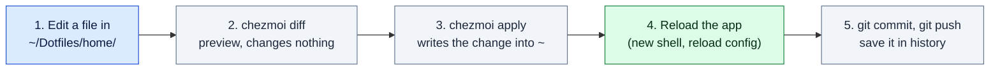
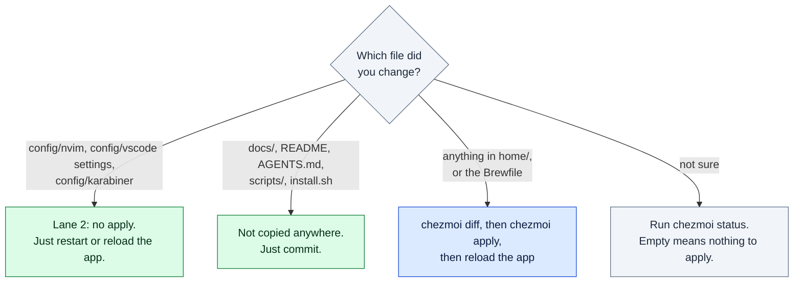

# 2. chezmoi basics

[← The big picture](01-big-picture.md) · Next: [How files are made →](03-how-files-are-made.md)

**What it is.** chezmoi (say "shay-mwah", French for "at my place") is a **dotfiles manager**. It reads the files in `~/Dotfiles`, which it calls the **source**, and writes them into your home folder, the **target**. Along the way it can fill in values (your email, a secret), make links, and run setup scripts.

**Why you have it.** One command sets up a new Mac. Secrets stay out of git. And one settings file can produce the configs for four different AI agents.

## The two commands that matter



- **`chezmoi diff`** shows exactly what *would* change in your home folder, and changes nothing. Always run it first.
- **`chezmoi apply`** makes your home folder match the repo. It only touches files that differ.

> **Diff**: a listing of the differences between two versions of a file. Lines starting with `-` would be removed, lines with `+` would be added.

## Reading file names in `home/`

chezmoi uses **prefixes and endings** on file names as instructions. Strip them off and you get the real name.

| In the repo | Means | Example |
|---|---|---|
| `dot_` | becomes a leading `.` | `dot_zshrc` → `~/.zshrc` |
| `.tmpl` | a **template**: values get filled in ([chapter 3](03-how-files-are-made.md)) | `dot_config/git/config.tmpl` → `~/.config/git/config` |
| `private_` | only you can read it (file permission 600) | `private_secrets.zsh.tmpl` → `~/.config/zsh/secrets.zsh` |
| `executable_` | can be run as a program | `private_dot_local/bin/executable_notes` → `~/.local/bin/notes` |
| `symlink_` | lane 2: a link into `config/` | `dot_config/symlink_nvim.tmpl` → `~/.config/nvim` |
| `modify_` | updates part of a file that an app also writes ([chapter 3](03-how-files-are-made.md)) | `dot_claude/modify_settings.json.tmpl` |
| `.chezmoiscripts/run_onchange_…` | a script that re-runs when its input changes ([chapter 3](03-how-files-are-made.md)) | installs apps when the Brewfile changes |

Prefixes stack: `private_dot_local/bin/executable_notes` is "`.local`, private" then "`notes`, executable".

## Do I need to run `chezmoi apply`?

`chezmoi apply` and `git commit` are **separate**:

- **`chezmoi apply`** copies files from `~/Dotfiles` into your home folder, so your Mac *uses* the change.
- **`git commit`** and **`git push`** *save* the change in history and on GitHub.

> **Commit**: a saved snapshot of the repo, with a message saying what changed. **Push**: send your commits to GitHub.

Follow this to decide:



The same thing as a table:

| You changed… | Where it lives | Run `chezmoi apply`? | What makes it take effect |
|---|---|---|---|
| Neovim config or plugins (including `lazy-lock.json`, `:Lazy update`) | `config/nvim/` | **No.** Live link. | Restart Neovim |
| VS Code `settings.json`, `keybindings.json` | `config/vscode/` | **No.** Live link. | Saves instantly, or reload the window |
| VS Code `mcp.json` | `agents.yaml` (`mcpServers`) | **Yes.** Generated. | Reload the window |
| Karabiner rules (changed in its app) | `config/karabiner/` | **No.** Live link. | Instant |
| Anything else in `home/` (zsh, git, Ghostty, herdr, AeroSpace, mise, tmux, agents, skills, your scripts) | `home/…` | **Yes.** It's a copy. | `apply`, then reload the app (below) |
| `Brewfile` | repo root | **Yes.** `apply` runs `brew bundle` when it changes. | `apply` |
| `docs/`, `README.md`, `AGENTS.md`, `scripts/`, `install.sh` | repo only | **No.** Nothing is copied. | Nothing to do |

> **Skills note:** `~/.claude/skills` is a link to `~/.agents/skills`, but that folder is a *copy* made from `home/dot_agents/skills/`. So edits to a skill **do** need `apply`.

### After `apply`, tell the app to reload

`apply` only writes the file. A program that's already running still has the old settings in memory.

| App | How to reload |
|---|---|
| zsh | Open a new tab, or run `exec zsh` |
| Ghostty | `Cmd+Shift+,` |
| herdr | `herdr server reload-config` |
| AeroSpace | `aerospace reload-config` |
| tmux | `Ctrl+F` then `r` (your tmux prefix is `Ctrl+F`) |
| git, mise | Takes effect on the next command |
| Claude / Copilot / Gemini | Start a new session |
| Hammerspoon | Menu-bar icon → Reload Config |

### If you're not sure, ask chezmoi

These two never change anything:
```sh
chezmoi status     # empty = nothing waiting to be applied
chezmoi diff       # shows exactly what apply WOULD change
```

**The safe habit:** when in doubt, run `chezmoi apply`. It only touches files that differ, and `chezmoi diff` shows you first. The risky mistake is the opposite one: editing a copied file in `~` directly. That edit gets overwritten by the next apply.

> **1Password popup:** `apply`, `diff` and `status` ask 1Password for approval, because your secrets file is part of the comparison. That's expected. See [chapter 7](07-secrets.md).

## Worked example: change a setting, end to end

This routine works for almost every file in lane 1. Say you want bigger gaps between windows in AeroSpace.

1. **Open the source file**, not the copy in `~/.config/aerospace/`.
   ```sh
   cd ~/Dotfiles
   nvim home/dot_config/aerospace/aerospace.toml
   ```
2. **Edit it.** Change `gaps.inner.horizontal = 8` to `12`. Save.
3. **Preview, then apply.**
   ```sh
   chezmoi diff      # shows exactly what will change in ~/.config/aerospace
   chezmoi apply     # approve the 1Password popup if it appears
   ```
4. **Reload the app** so it reads the new file.
   ```sh
   aerospace reload-config
   ```
   An error here means a typo in the file. Fix it and reload again.
5. **Check it** worked.
6. **Save it.**
   ```sh
   scripts/check.sh     # runs the repo's checks
   git add -A
   git commit -m "style(aerospace): increase window gaps to 12"
   git push
   ```
   Or, in a Claude session in `~/Dotfiles`, say "commit this".

**Faster:** `cze ~/.config/aerospace/aerospace.toml` opens the *source* file and applies it when you save, so you can skip step 3.

**Undo a change you haven't committed:**
```sh
git checkout -- home/dot_config/aerospace/aerospace.toml
chezmoi apply && aerospace reload-config
```

Other tools follow the same six steps. Only the file in step 1 and the reload in step 4 change:

| Files (in `home/`) | Reload in step 4 |
|---|---|
| `dot_config/aerospace/`, `ghostty/`, `herdr/`, `lf/`, `zathura/`, `dot_tmux.conf`, `dot_hammerspoon/` | The app's own reload (table above) |
| `dot_config/zsh/*.zsh`, `dot_zshrc`, `dot_zshenv`, `dot_zprofile` | New tab, or `exec zsh` |
| `dot_config/git/ignore`, `dot_config/git/config.tmpl` | Nothing: the next git command uses it |
| `private_dot_local/bin/executable_notes`, `executable_launcher`, `executable_agents-init` | Nothing: the next run uses it |

A few kinds of file work differently; [chapter 3](03-how-files-are-made.md) covers them.

## The 20% you'll use

| Command | Short alias | Does |
|---|---|---|
| `chezmoi diff` | `czd` | Show what *would* change in `~`. **Run this first.** |
| `chezmoi apply` | `cza` | Make `~` match the repo |
| `chezmoi edit --apply ~/.zshrc` | `cze ~/.zshrc` | Open the **source** of a file; apply on save |
| `chezmoi status` | | List files waiting to be applied |
| `chezmoi add ~/.somerc` | | Start managing an existing file (creates the source with the right name) |
| `chezmoi re-add` | | You edited a copied file in `~` by mistake: copy it back into the repo |
| `chezmoi managed` | | List everything chezmoi manages |
| `chezmoi update` | | `git pull` + apply (use this on another Mac) |
| `chezmoi doctor` | | Health check |
| `dot` | | `cd ~/Dotfiles` |

> **Alias**: a short name for a longer command, defined in `home/dot_config/zsh/aliases.zsh`. `czd` is just `chezmoi diff`.

Two more things to know:
- **Deleting or renaming a file in `home/`:** chezmoi does **not** delete the old file from `~`. Remove it yourself (`rm ~/the/old/file`), then commit.
- **Before committing**, run `scripts/check.sh`. It tests the agent settings and scripts, and scans for secrets. A **pre-commit hook** also runs **gitleaks** and refuses the commit if it finds a secret. ([Chapter 7](07-secrets.md))

## Try it (10 min)

1. `cze ~/.config/zsh/aliases.zsh`. Add `alias hi='echo hello'` and save. It applies automatically.
2. Open a new terminal tab and type `hi`.
3. `dot && git diff` shows your change in the repo. Commit it, or undo it with `git checkout -- . && chezmoi apply`.

## When it breaks

- ***"…has changed since chezmoi last wrote it"***: you (or an app) edited the copy in `~`. Run `chezmoi diff` to look; then `chezmoi re-add` to keep your edit, or `chezmoi apply --force` to throw it away.
- **A template error during apply**: see [chapter 3](03-how-files-are-made.md#templates).
- **1Password errors on apply**: unlock the 1Password app, and check that `op vault list` shows **Dev**.
- **Docs**: <https://chezmoi.io/user-guide/command-overview/>

Next: [How files are made →](03-how-files-are-made.md)
