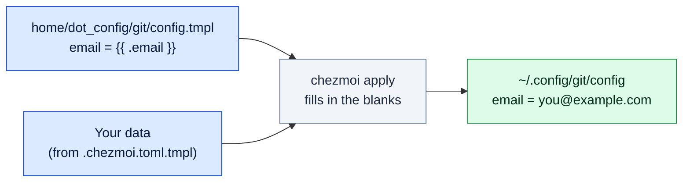
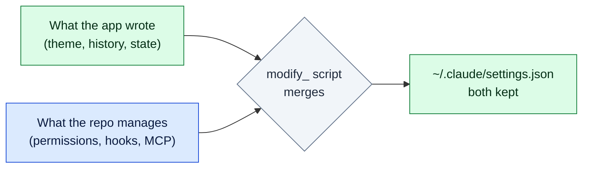

# 3. How files are made

[← chezmoi basics](02-chezmoi-basics.md) · Next: [The terminal →](04-terminal.md)

[Chapter 2](02-chezmoi-basics.md) covered plain copies. A few kinds of file do more than copy, and they're the ones that can look like magic. This chapter explains each one. You only need this when you edit one of these files, so skim it now and come back later.

| Kind | You can spot it by | Section |
|---|---|---|
| Templates | name ends in `.tmpl`, contents have `{{ … }}` | [Templates](#templates) |
| Generated files | one source file feeds several outputs | [Generated files](#generated-files) |
| Merged files | name starts with `modify_` | [Merged files](#merged-files-modify_) |
| Scripts that run on apply | in `home/.chezmoiscripts/` | [Scripts that run on apply](#scripts-that-run-on-apply) |
| chezmoi's own settings | `home/.chezmoi.toml.tmpl`, `home/.chezmoiignore` | [chezmoi's own settings](#chezmois-own-settings) |

## Templates

**What it is.** A **template** is a file with blanks in it. The blanks look like `{{ .email }}`, and chezmoi fills them in when it applies. Any file whose name ends in `.tmpl` is a template.

**Why.** The same repo can produce slightly different files: your real email in the git config, a secret pulled from 1Password, a path that depends on your home folder. The repo itself stays free of secrets.



The template language is **Go templates**, the one chezmoi is written in. You'll mostly see three patterns:

| You see | Means |
|---|---|
| `{{ .email }}` | Insert a value |
| `{{ if eq .chezmoi.os "darwin" }} … {{ end }}` | Only include this part on a Mac (`darwin` is macOS's internal name) |
| `{{ range .agents.allowCommands }} … {{ end }}` | Repeat this part once for each item in a list |

A typo in a template makes `apply` fail with an error naming the file. To see what a template produces **without applying anything**:
```sh
chezmoi execute-template < home/dot_config/git/config.tmpl
```
To see what the *other* kind of computer would get, pretend to be it: add `--override-data '{"chezmoi":{"os":"linux"}}'` on the M2 (or `"darwin"` on a spare). `scripts/check.sh` checks the scripts both ways.

- Your name and email come from `home/.chezmoi.toml.tmpl`, not from the git template.
- `private_secrets.zsh.tmpl` reads from 1Password whenever it has secrets in it, so expect a popup ([why](07-secrets.md#why-does-1password-keep-asking)). After changing it, open a new shell.
- **Template instructions run even inside comments.** A `{{ … }}` on a line starting with `#` still runs: the `#` only matters to the shell later, not to chezmoi. To switch a line off, delete it, or wrap it in a template comment: `{{/* … */}}`.

## Generated files

**What it is.** Some settings are written **once** and turned into **several** files. You edit the one source; chezmoi writes all the outputs. These are lane 3 from [chapter 1](01-big-picture.md#three-ways-a-file-gets-to-your-home-folder).

**Why.** Claude, Copilot, Gemini and VS Code each want their settings in a different file and format. Keeping four copies in step by hand is how mistakes creep in.

| You want to change… | Edit this one file | It generates | Then |
|---|---|---|---|
| What agents know about you and how they work | `home/.chezmoitemplates/agents.md` | `~/.claude/CLAUDE.md`, `~/.copilot/copilot-instructions.md`, `~/.gemini/GEMINI.md` | `apply`, start a **new** agent session |
| What agents may run, which files are secret, and MCP servers | `home/.chezmoidata/agents.yaml` | Claude and Gemini settings, Gemini policy, Copilot MCP config, VS Code `mcp.json`, Claude's secret-guard hook, the `copilot` wrapper in `agents.zsh` | `scripts/check.sh`, `apply`, `exec zsh`, start a **new** agent session |
| A skill | `home/dot_agents/skills/<name>/SKILL.md` | `~/.agents/skills/<name>/` | `apply`, start a new agent session |

**Never edit the outputs.** They're rewritten on the next apply. [Chapter 5](05-ai-agents.md) explains `agents.yaml` in detail.

> **YAML**: a simple text format for settings, built from `name: value` lines and indented lists (`- item`). `agents.yaml` is one.

## Merged files (`modify_`)

**What it is.** Some apps write to their own settings file while they run. Claude Code, for example, saves your UI preferences into `~/.claude/settings.json`. If chezmoi replaced that whole file, it would wipe those preferences. So for these files chezmoi **merges** instead: it updates only the parts it manages and leaves the rest alone.



Files that work this way: Claude's and Gemini's settings, Copilot's MCP config, VS Code's `mcp.json`.

Three rules follow from this:

1. **Settings the repo manages win.** If you change one of them inside the app (say, Claude's default permission mode), the next `apply` puts it back. To make the change stick, change it in `agents.yaml` or the `modify_*.tmpl` file.
2. **Settings the repo doesn't manage are yours.** The app can change them freely.
3. **MCP server lists are owned completely.** The whole list is replaced on apply. A server you add from inside an app (for example with `claude mcp add`) disappears on the next apply. Add servers in `agents.yaml` instead.

> **JSON**: the text format most apps use for settings: `{"name": "value"}`. **jq**: a command-line tool for reading and changing JSON. The `modify_` scripts use it to do the merge.

## Scripts that run on apply

**What it is.** Files in `home/.chezmoiscripts/` are scripts, not configs. chezmoi runs them during `apply`, **but only when their input has changed** since the last run. That's what the `run_onchange_` part of the name means.

| You change | `apply` also runs | If it fails |
|---|---|---|
| `Brewfile` | Trusts every `tap` listed in the Brewfile, then `brew bundle` (installs new apps and tools). On the spare Ubuntu machines it skips the Mac-only part ([chapter 14](14-spare-linux.md)) | It prints the exact command to rerun. Apps that need your password (like Tailscale) must be installed by you in a terminal. |
| `home/dot_config/mise/config.toml` | `mise install` | `mise doctor` |
| MCP servers in `agents.yaml` | Registers them with Claude Code, and removes ones you deleted | `claude mcp list` |

The same script also connects Claude and Copilot to herdr ([chapter 4](04-terminal.md)).

**If a script fails, `apply` won't retry it by itself.** "Run on change" means "run once per version of the input". The scripts report failures but still finish "successfully" (so one problem doesn't stop the rest of `apply`), and chezmoi marks that version as done. Fix the problem, then run the command the error message prints, for example `brew bundle --file="$HOME/Dotfiles/Brewfile"`.

One difference to know: chezmoi's script runs `brew bundle --no-upgrade`, which only installs what's missing. Running plain `brew bundle` yourself **also upgrades** anything outdated, git included, so you may see a few one-off prompts afterwards, such as the Keychain asking again on your next `git push` ([chapter 2](02-chezmoi-basics.md#when-it-breaks)).

> **Tap**: an extra source of Homebrew packages, published by someone other than Homebrew (`tap "FelixKratz/formulae"`). Recent Homebrew refuses a tap's formulas until you **trust** it (`brew trust <tap>`), because installing runs that publisher's code. The brew script trusts every tap listed in the Brewfile, since listing it there is your decision to trust it.

## chezmoi's own settings

- **`home/.chezmoi.toml.tmpl`** holds chezmoi's settings (diff tool, editor) and the *questions* for your name and email. chezmoi turns it into its real config file, `~/.config/chezmoi/chezmoi.toml`, but only when you run `chezmoi init`. The first `init` on a machine **asks** for your name and email (`promptStringOnce`) and saves the answers only in that machine's config, so they never appear in this public repo; later `init`s reuse the saved answers. To change one, edit `~/.config/chezmoi/chezmoi.toml` (or delete the line and run `chezmoi init` to be asked again). See `chezmoi data` for every value templates can use. So after editing it, run `chezmoi init` once, then `apply`. If you forget, chezmoi warns *"config file template has changed, run chezmoi init"*.
- **`home/.chezmoiignore`** lists files chezmoi should skip, for example the Mac-only ones on a Linux machine. Takes effect on the next `apply`.

Next: [The terminal →](04-terminal.md)
