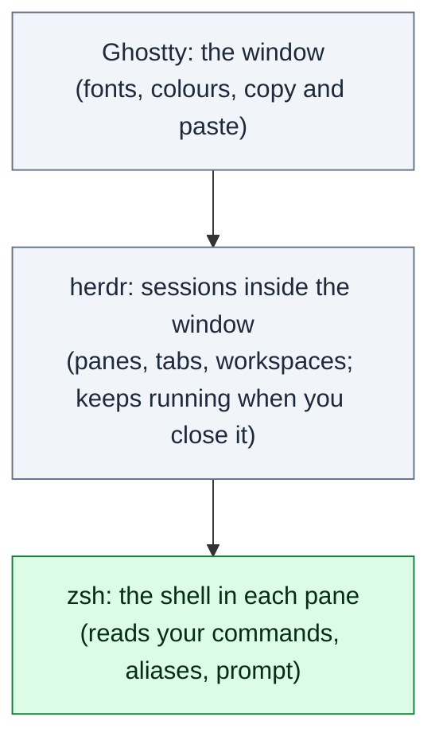
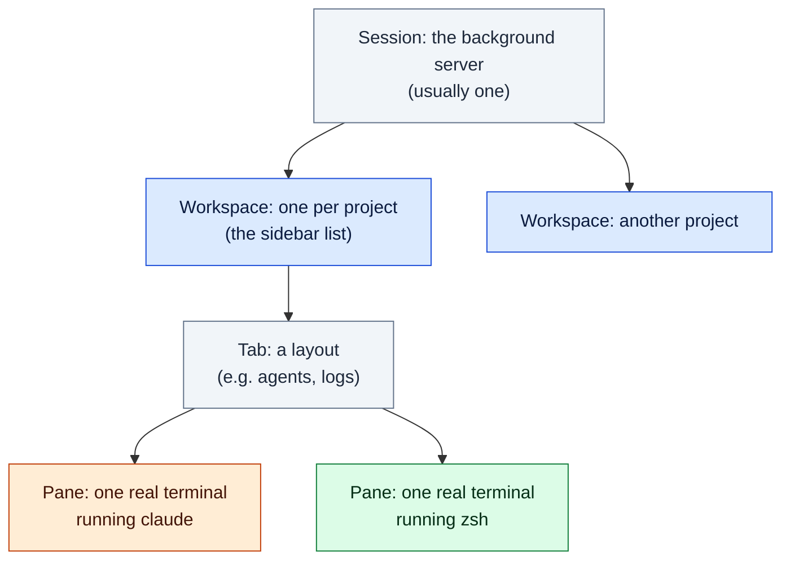
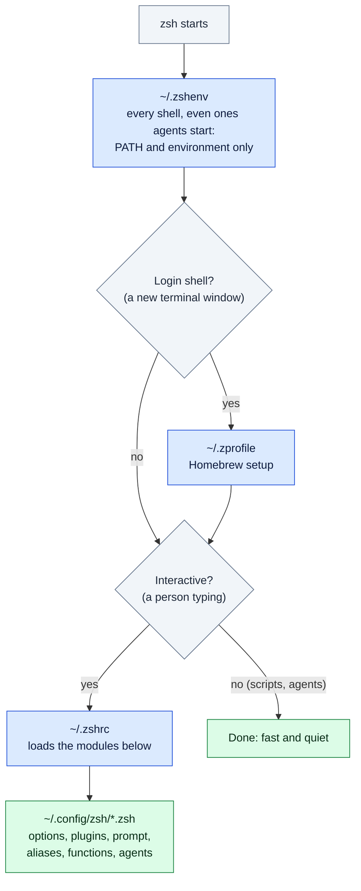

# 4. The terminal: Ghostty, herdr, zsh

[← How files are made](03-how-files-are-made.md) · Next: [AI agents →](05-ai-agents.md)

Three layers sit between you and your commands. It helps to know which one does what:

> **Terminal** (or terminal emulator): the app that shows a text window where you type commands. **Shell**: the program inside it that reads and runs those commands. Ghostty is the terminal; zsh is the shell.

## Ghostty: the window

**What it is.** A fast, native macOS terminal app. It replaced WezTerm.

**Why you have it.** It's fast and simple, and it supports the newer terminal features AI agents use: desktop notifications, images, and Shift+Enter for a new line in a prompt. Splits and tabs are herdr's job, so Ghostty's config stays tiny, and switching terminals later would cost little.

**The 20% you'll use**

| Action | Keys |
|---|---|
| New window / tab | `Cmd+N` / `Cmd+T` |
| Close | `Cmd+W` |
| Reload config | `Cmd+Shift+,` |
| Text smaller / bigger / back to normal (**temporary**) | `Cmd+-` / `Cmd+=` / `Cmd+0` |
| New line in an agent prompt (instead of sending) | `Shift+Enter` |
| Copy | Just select with the mouse (copy-on-select is on) |
| Paste | `Cmd+V` |

**Making Ghostty your "default" terminal.** macOS has no single default-terminal setting, so it's set in a few places:
- Dock: right-click the Ghostty icon → **Options → Keep in Dock** (and **Open at Login** if you like).
- Keyboard: `Alt+Enter` opens a new Ghostty window from anywhere (an AeroSpace shortcut, [chapter 9](09-desktop.md)).
- VS Code: **Open in External Terminal** uses Ghostty (`terminal.external.osxExec` in `config/vscode/settings.json`). VS Code's built-in terminal panel is separate and unchanged.
- Finder: right-click a `.command` or `.sh` file → **Get Info → Open with → Ghostty → Change All…**

**Config:** `home/dot_config/ghostty/config` (lane 1). Edit it, run `chezmoi apply`, then press `Cmd+Shift+,` in Ghostty.

**Changing the font size for good.** `Cmd+-` and `Cmd+=` only change the running app; the size resets when Ghostty restarts. Use them to *find* a size you like, then make it permanent:
1. Count your `Cmd+-` presses (one point each), then press `Cmd+0` to reset.
2. `cze ~/.config/ghostty/config` and change `font-size = …` to the new number. Save; `cze` applies it.
3. Press `Cmd+Shift+,` to reload.
4. Check: `chezmoi diff` prints nothing, `git diff` shows the one-line change. Commit it.

**Try it.** Open Ghostty and run `claude`. Type a line, press `Shift+Enter`, type a second line, then press `Enter`. You just sent a two-line prompt.

**When it breaks**
- Fonts look wrong: the config uses `JetBrainsMono NFM`. Check it's installed: `/Applications/Ghostty.app/Contents/MacOS/ghostty +list-fonts | grep JetBrains`.
- Check the config for mistakes: `/Applications/Ghostty.app/Contents/MacOS/ghostty +validate-config`.

## herdr: where your agents live

**What it is.** A **terminal multiplexer**: one window holding many terminals, organized into workspaces and tabs. A background **server** (a program that keeps running on its own) owns those terminals, so they keep going after you close Ghostty. Unlike older multiplexers such as tmux, herdr understands AI agents and marks each one **working**, **blocked** (waiting for you), **done** or **idle**.

**Why you have it.** With two or three agents working at once, you need to see at a glance which one needs you. Closing a window by accident shouldn't kill a 20-minute agent run. Your phone also connects through herdr ([chapter 9](09-desktop.md)).

### Words you need

| Word | Meaning |
|---|---|
| **Session** | The background server. You usually have one. Running `herdr` connects you to it. |
| **Workspace** | One per project (the list in the sidebar). |
| **Tab** | A layout inside a workspace (e.g. "agents", "server logs"). |
| **Pane** | One real terminal. |
| **Prefix** | `Ctrl+B`. Press it, **let go**, then press the action key. |
| **Detach** | Leave herdr without stopping anything. Everything keeps running in the background. |

### The 20% you'll use

| Action | Keys / command |
|---|---|
| Start, or reconnect | `herdr` (from a normal Ghostty tab) |
| **Detach** (everything keeps running) | `Ctrl+B` then `q` |
| Show every key binding | `Ctrl+B` then `?` |
| Split right / split down | `Ctrl+B` then `v` / `Ctrl+B` then `-` |
| Move between panes | `Ctrl+B` then `h` `j` `k` `l`, or **click** |
| Zoom a pane full-size (toggle) | `Ctrl+B` then `z` |
| Close pane | `Ctrl+B` then `x` |
| New tab / next / previous | `Ctrl+B` then `c` / `n` / `p` |
| New workspace | `Ctrl+B` then `Shift+N`, or click **new** in the sidebar |
| Switch workspace | `Ctrl+B` then `w`: the sidebar becomes a list; arrows (or `j`/`k`) to move, `Enter` to switch, `Esc` to cancel. Or click it |
| New git worktree workspace | `Ctrl+B` then `Shift+G` (or `wt`, [chapter 6](06-worktrees.md)) |
| Lazygit popup | `Ctrl+B` then `Alt+G` |
| Open a project as a workspace | `tt` (your project picker) |
| Stop everything for real | `herdr server stop` |

The mouse works for everything: click panes, drag borders, right-click for menus. You don't need the keys on day one.

**Try it (10 min)**
1. In Ghostty: `cd ~/Projects/go-todos-htmx && herdr`.
2. Run `claude` in the pane. Watch the sidebar status change as it works.
3. `Ctrl+B` then `v` to split. In the new pane, run `git status`.
4. `Ctrl+B` then `q` to detach. **Quit Ghostty completely** (`Cmd+Q`).
5. Open Ghostty again and run `herdr`. Everything is still there, Claude included.

**When it breaks**
- *"Saved directory is unavailable"*: a workspace points at a deleted folder. Close it: right-click the workspace → close, or `herdr workspace list` then `herdr workspace close <id>`.
- **A command behaves like an old version** (for example `wt prune` creates a branch called `prune`): that pane's shell started before the change and still has the old functions in memory. herdr keeps panes alive for days, so this happens after any change to `~/.config/zsh/`. Run `exec zsh` in the pane, or open a new one. `whence -v <name>` says where a command came from; `type -f <name>` shows the version the shell actually has.
- Running `herdr` inside herdr is blocked on purpose. Use `tt` or a new workspace instead.
- An agent shows the wrong status: `herdr agent list`, then `herdr agent explain <pane-id>`.
- Config: `home/dot_config/herdr/config.toml`. After `chezmoi apply`, run `herdr server reload-config`.
- Docs: <https://herdr.dev/docs/>

**tmux** is still installed as a fallback multiplexer. Its prefix is `Ctrl+F`; `tmuxf` picks a session and `tmuxkill` ends one.

## zsh: your shell

**What it is.** zsh is the shell: it reads what you type, runs commands, and shows the prompt. Its settings are split into small files so each one is easy to find.

**Which file runs when.** zsh reads several files when it starts. Which ones depends on the kind of shell:

> **PATH**: the list of folders the shell searches when you type a command name. If `node` runs the wrong version, PATH is usually why. **Environment variable**: a named value every program can read, like `EDITOR=nvim`.

**Where to edit** (all lane 1, in `home/dot_config/zsh/`):

| File | Holds |
|---|---|
| `env.zsh` | PATH and environment variables |
| `options.zsh` | History, vi mode, key bindings |
| `plugins.zsh` | The plugin list (autosuggestions, syntax highlighting…) |
| `prompt.zsh` | What your prompt looks like |
| `aliases.zsh` | Short names for commands |
| `functions.zsh` | Small helpers: `cdf`, `fav`, `tt`, `updater`… |
| `agents.zsh.tmpl` | AI agent helpers: `wt`, `??`, the `copilot` wrapper ([chapter 5](05-ai-agents.md)) |
| `local.zsh` | Your untracked, machine-only extras (create it if you want; not in git) |

**Vi mode.** Your shell uses Vim keys. `[I]` in the prompt means insert mode, `[N]` normal mode. Press `Esc` then `v` to edit a long command (or an agent prompt) in Neovim.

Next: [AI agents →](05-ai-agents.md)
