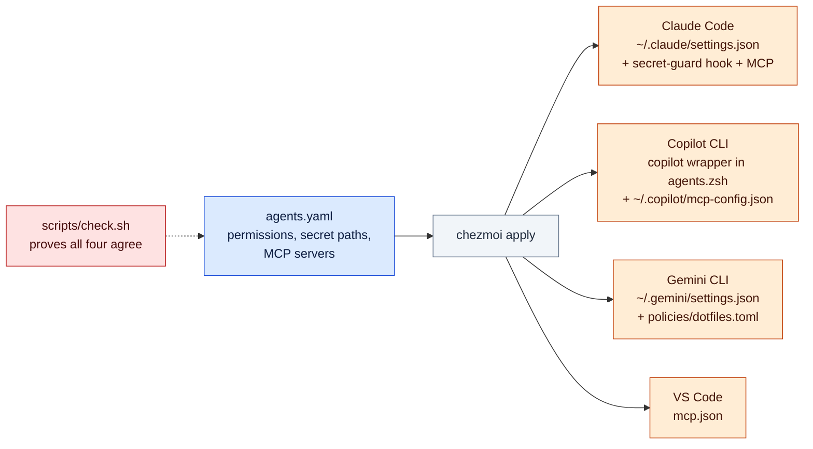
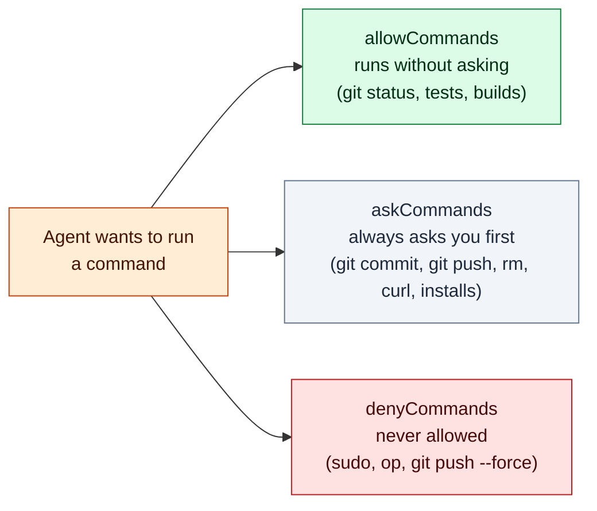
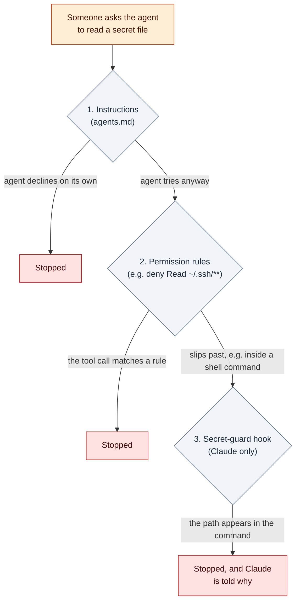

# 5. AI agents

[← The terminal](04-terminal.md) · Next: [Git worktrees and `wt` →](06-worktrees.md)

> **AI coding agent**: an AI you talk to in the terminal that can also *act*: read your files, edit them, and run commands such as tests. You describe the goal; it works in steps and asks before doing anything risky.

You have three agents that run in the terminal, plus Copilot inside VS Code. They're **interchangeable for most work**. Pick one as your main tool (Claude Code is a good default) and use the others for a second opinion or when you run out of quota.

| | Claude Code | GitHub Copilot CLI | Gemini CLI |
|---|---|---|---|
| Start | `claude` | `copilot` | `gemini` |
| Good at | Long multi-file changes, careful reasoning | GitHub work (PRs, issues, Actions), choosing among many models | Big context, quick questions |
| One-shot (no chat) | `claude -p "..."` | `copilot -p "..."`, or your `?? question` | `gemini -p "..."` |

> **CLI** (command-line interface): a program you use by typing in the terminal, as opposed to clicking in a window.

## What all four share

Everything below is set up once, in this repo, and given to every agent:

| Shared thing | Where it's written | What it does |
|---|---|---|
| **Instructions** | `home/.chezmoitemplates/agents.md` | "Who I am, how I work": Herd for PHP, conventional commits, ask before pushing… |
| **Skills** | `home/dot_agents/skills/*/SKILL.md` | Step-by-step playbooks the agent loads **only when relevant**: `commit`, `code-review`, `pr-description`, `tdd`, `laravel-conventions`, `go-conventions`, `python-conventions`, `ts-js-conventions`, `notes-markdown`, `herdr` |
| **Permissions** | `home/.chezmoidata/agents.yaml` | What runs without asking, what always asks, what's never allowed |
| **Secret paths** | same `agents.yaml` | Files agents may never read or write |
| **MCP servers** | same `agents.yaml` | Extra tools: `context7` (up-to-date library docs) and `time` (the current time in your timezone) |

> **Skill**: a short instruction file an agent reads when the task matches, like a recipe card. **MCP** (Model Context Protocol): a standard way to plug extra tools into an agent. An **MCP server** is one such tool; it's either a web address (`http`) or a small program the agent starts on your Mac (`stdio`).

### One file, four agents

Each agent wants its settings in its own file and format. You write them once in `agents.yaml`, and chezmoi translates ([chapter 3](03-how-files-are-made.md#generated-files)):



**Not every list reaches every agent.** Each agent supports different kinds of settings, so each list in `agents.yaml` goes only where it can be expressed:

| List in `agents.yaml` | Claude Code | Gemini CLI | Copilot CLI | VS Code |
|---|---|---|---|---|
| `allowCommands` (run without asking) | ✅ `Bash(mix test:*)` | ✅ `commandPrefix` | ❌ no settings file for it | ❌ |
| `askCommands` (always ask) | ✅ | ✅ | ❌ (it asks anyway) | ❌ |
| `denyCommands` (never) | ✅ | ✅ | single-word ones only (`sudo`, `op`) | ❌ |
| `denyPaths` (never read or write) | ✅ + guard hook | ✅ | ✅ | ❌ |
| `copilot.allowTools` | | | ✅ via the `copilot` wrapper | |
| `mcpServers` (extra tools) | ✅ | ✅ | ✅ | ✅ |

So **allowing a command for Copilot too** means adding it in two places: `allowCommands` (for Claude and Gemini) and `copilot.allowTools` as `shell(mix test)`. Copilot matches the command plus one more word, so `shell(mix test)` covers `mix test` and `mix test --failed`. To see where a change lands before applying it, run `chezmoi diff`: only the files that change are listed.

**After changing `agents.yaml`**, run `scripts/check.sh`. It builds every agent's settings from the file and fails if any of them disagree with it, so a rule can't quietly go missing for one agent. Then `chezmoi apply`, `exec zsh`, and start a new agent session.

## What agents may do

Every command an agent wants to run lands in one of three buckets:



Anything not in any list gets the agent's normal behaviour, which is to ask you. File **edits** inside your project are approved automatically, so agents don't interrupt you for every change.

### How secrets are protected: three layers

Secret files (`.env` files, your SSH keys, `~/.config/zsh/secrets.zsh`, your 1Password CLI config; the list is `denyPaths` in `agents.yaml`) are protected three times, so one layer missing something isn't a disaster:



> **Hook**: a small script an agent runs automatically at a fixed moment, such as "just before using a tool". Claude has two from this repo, in `~/.claude/hooks/dotfiles/`:
> - `guard-secrets.sh` runs before every tool call and blocks any that touch a secret path.
> - `notify.sh` shows a macOS notification when Claude is waiting for your answer, so an agent in a background pane doesn't sit unnoticed.

To see the guard work without involving an agent, feed it a pretend tool call. This doesn't read the file:
```sh
echo '{"tool_name":"Bash","tool_input":{"command":"cat ~/.config/zsh/secrets.zsh"}}' \
  | ~/.claude/hooks/dotfiles/guard-secrets.sh; echo "exit=$?"
```
It prints a "Blocked…" message and `exit=2`, the code that tells Claude to stop.

**Copilot is a special case.** Copilot CLI has no settings file for permissions, so your `copilot` command is a small wrapper (in `~/.config/zsh/agents.zsh`) that passes the rules every time it starts. After changing its rules, open a new shell.

## Talking to an agent well

1. **Start in the project folder.** The agent sees that folder.
2. **Say what "done" looks like.** "Add a `DELETE /todos/{id}` endpoint with a test. Done = `go test ./...` passes."
3. **Point at files** with `@`: "Look at @handlers/todos.go".
4. **Ask for a plan first on big tasks.** "Plan it, don't code yet." In Claude, `Shift+Tab` switches to plan mode.
5. **Review before you commit.** Ask it to "review my changes" (uses the `code-review` skill), then "commit this" (uses the `commit` skill).
6. **Keep sessions short.** When a task is done, run `/clear` and start fresh. Long chats get confused.

## Keys and commands worth knowing

**Claude Code**

| | |
|---|---|
| Interrupt it | `Esc` |
| Rewind to an earlier message (undo) | `Esc` `Esc`, or `/rewind` |
| Cycle modes (normal → auto-accept edits → plan) | `Shift+Tab` |
| Run a shell command yourself | start the line with `!` |
| Mention a file | `@path/to/file` |
| New conversation | `/clear` |
| Shrink a long conversation | `/compact` |
| See skills / MCP / permissions / hooks | `/skills`, `/mcp`, `/permissions`, `/hooks` |
| How full is the context? | `/context` |
| Create a project `CLAUDE.md` | `/init` (but prefer `agents-init`, below, which works for all three agents) |

> **Context**: everything the agent currently "has in mind": your messages, files it read, command output. It has a size limit; `/compact` and `/clear` free it up.

**Copilot CLI**

| | |
|---|---|
| Help / all commands | `/help` |
| Pick a model | `/model` |
| Review your changes | `/review` (or `/security-review`) |
| See the diff it made | `/diff` |
| Undo to an earlier turn | `/rewind` |
| Move your work into a new worktree | `/move` |
| Pull request for this branch | `/pr` |
| Skills / MCP / instructions | `/skills`, `/mcp`, `/instructions` |
| Resume an old session | `copilot --resume`, or `/resume` |

**Gemini CLI**: `/help`, `/skills list`, `/mcp`. It asks before editing until you **trust the folder** (it offers when you start in a new folder).

**Your shortcut:** `?? <question>` asks Copilot a quick question and runs nothing. Try `?? find files bigger than 1GB`.

## Project-level instructions: `AGENTS.md`

Your global instructions apply everywhere. For rules that belong to **one project** ("use Pest, not PHPUnit"; "run `make test`"), add an `AGENTS.md` file at the project's root. All three agents read it.

The quickest way to start one:
```sh
cd ~/Projects/some-project
agents-init --print     # preview
agents-init             # write AGENTS.md and CLAUDE.md
```
`agents-init` looks at the project (a `go.mod`, a `composer.json`, a `package.json`…), writes the real test, lint and format commands into `AGENTS.md`, and creates a one-line `CLAUDE.md` that points Claude at it. Fill in the `TODO` lines and commit both files.

## Adding an MCP server

Add an entry under `mcpServers` in `home/.chezmoidata/agents.yaml`:
```yaml
mcpServers:
  my-server:            # a web address
    type: http
    url: https://example.com/mcp
  my-tool:              # a program on your Mac
    type: stdio
    command: uvx
    args: [some-mcp-package]
```
Then `scripts/check.sh` and `chezmoi apply`. All four agents get it. Deleting an entry removes it from all four on the next apply. **Never put secrets in this file**: the repo is public.

## Try it (15 min)

1. `cd ~/Projects/go-todos-htmx && claude`
2. "Explain this project's structure in 10 bullet points."
3. "Add a test for one untested function."
4. Watch it run `go test` without asking (allowed). Then say "commit this". It should **ask before committing**, because commits are in the ask list.
5. Type `/skills`, `/mcp` and `/hooks` to see what's loaded.

## When it breaks

- **An agent ignores your instructions**: check they're loaded. In Copilot: `copilot instruction list`. In Claude: `/memory`.
- **Too many permission prompts**: add the command to `allowCommands` in `agents.yaml`, run `scripts/check.sh`, then `chezmoi apply`. For Copilot, also add it under `copilot.allowTools`, then open a new shell.
- **Claude says "Blocked by the dotfiles secret guard"**: it tried to touch a secret path. That's working as intended; get the value yourself.
- **An MCP server is missing**: `claude mcp list`. If it's not there, run `chezmoi apply` and read its output.
- **Never** use `--dangerously-skip-permissions` or `--yolo` outside a throwaway folder.

Next: [Git worktrees and `wt` →](06-worktrees.md)
