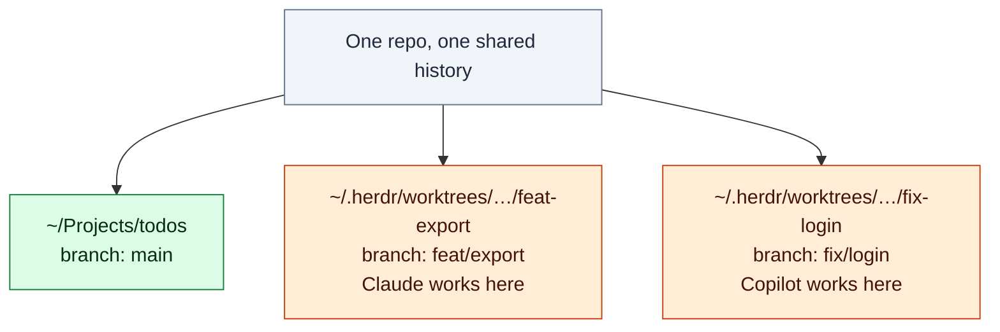
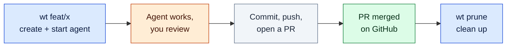
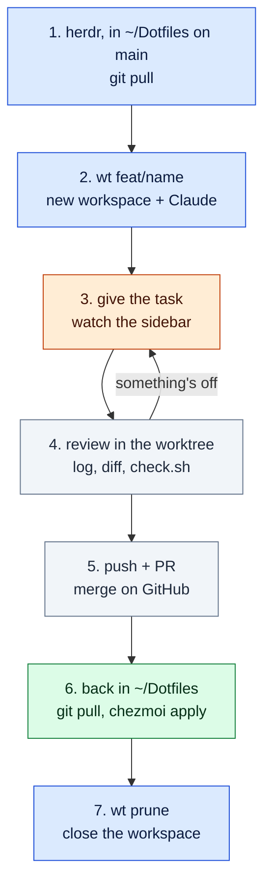

# 6. Git worktrees and `wt`

[← AI agents](05-ai-agents.md) · Next: [Secrets →](07-secrets.md)

## First, two git words

> **Branch**: a separate line of work in a repo. You make a branch, change things on it, and later **merge** it back into `main` (usually through a **pull request**, or **PR**: a request on GitHub to merge, where changes are reviewed first).
>
> **Checkout**: the files you see in the project folder. Normally a repo has **one** checkout, so you can only have one branch "open" at a time.

## What a worktree is

A **worktree** is a **second checkout** of the same repo, in another folder, on another branch. Both folders share one history, but their files are separate.



**Why you have it.** Two agents editing the same folder trample each other's files. With one agent per worktree, each works in peace, and each branch becomes its own pull request that's easy to review.

## Your helper: `wt`

`wt` creates a worktree and starts an agent in it, in one step:

```
wt <branch> [claude|copilot|gemini|none] [base]
```

- **Inside herdr:** creates the worktree (under `~/.herdr/worktrees/`), opens it as a **new workspace**, and starts the agent (Claude by default).
- **Outside herdr:** creates `../<repo>--<branch>` next to the repo, moves you there, and starts the agent.
- If the worktree already exists, it just takes you back to it.

## The life of a worktree



## The 20% you'll use

```sh
wt feat/delete-todo            # new branch + worktree + Claude
wt fix/login-bug copilot       # same, with Copilot
wt ls                          # see all worktrees and their folders
wt rm fix/login-bug            # remove one (refuses if it has unsaved work; add --force)
wt prune                       # remove every clean worktree whose branch is merged
```

**What `wt prune` removes.** It lists what it plans to do and asks before removing anything. A worktree is removed only if:
- it has no uncommitted changes, **and**
- you made at least one commit on its branch (a brand-new branch is never treated as "merged"), **and**
- the branch is merged: it's contained in `main`, or `gh` says its pull request was merged. That second check catches **squash merges**, where GitHub combines your commits into one new commit.

Inside herdr, close the leftover workspace yourself after removing a worktree.

## Worked example: add a feature with an agent, end to end

This is the loop you'll repeat for every change an agent makes, shown with a real one from November 2026: letting **Copilot** run `mix test` and `mix format` without asking. It takes about 15 minutes, most of it the agent working while you do something else.



**herdr in one breath** (more in [chapter 4](04-terminal.md#herdr-where-your-agents-live)): the **sidebar** on the left lists **workspaces** (one per project or worktree), each holding **panes** (terminals). Keys start with the **prefix** `Ctrl+B`: hold Caps Lock (Ctrl, on the M2), tap `B`, **let go**, then the action key. The mouse works for everything too.

| You want to | Keys |
|---|---|
| Switch workspace | click it in the sidebar, or `Ctrl+B` `w`, then arrows or `j`/`k`, `Enter` |
| Open a shell next to the agent | `Ctrl+B` `v` (splits right, in the same folder) |
| Move between panes | `Ctrl+B` `h`/`j`/`k`/`l`, or click |
| Close a workspace | right-click it in the sidebar |
| Leave herdr, keeping everything running | `Ctrl+B` `q` |

### 1. Start in herdr, in `~/Dotfiles`, on a fresh `main`

In Ghostty (`Alt+Enter` for a new window):

```sh
herdr                                   # starts herdr, or reconnects to it
cd ~/Dotfiles && git switch main && git pull
exec zsh                                # only if this pane is old: loads the current wt
```

**Check:** the prompt shows `~/Dotfiles main`. Starting from an up-to-date `main` matters: a branch from an old `main` would undo newer changes when applied ([chapter 2](02-chezmoi-basics.md#the-routine-start-to-finish)).

### 2. Create the agent's worktree

```sh
wt feat/copilot-mix                     # Claude; or: wt feat/x copilot / none (gemini can't sign in, chapter 5)
```

**Expect:** a new workspace in the sidebar named after the branch, herdr switched to it, and Claude starting in a folder under `~/.herdr/worktrees/Dotfiles/`. Your `~/Dotfiles` stays on `main`, untouched.

### 3. Give the task, then let it work

Be specific about **what**, **where**, **how to check** and **where to stop**:

> Add `shell(mix test)` and `shell(mix format)` to `agents.copilot.allowTools` in `home/.chezmoidata/agents.yaml`, next to the other test runners. Run `scripts/check.sh`. Commit with a conventional commit message. Don't push.

Watch the sidebar: each workspace shows **working**, **blocked** (waiting for you, for example to approve a `git commit`) or **done**. You can switch to another workspace, or leave herdr (`Ctrl+B` `q`), and come back; the agent keeps going. When it asks to run something, read it first: that's your `agents.yaml` rules at work ([chapter 5](05-ai-agents.md)).

### 4. Review its work yourself

When it says **done**, press `Ctrl+B` `v` in the agent's workspace to open a shell beside it. `pwd` should show the worktree folder. Then:

```sh
git log --oneline main..HEAD            # expect: one commit, feat(agents): …
git diff main                           # expect: exactly the 2 lines you asked for
scripts/check.sh                        # expect: all checks pass
chezmoi --source "$PWD" diff ~/.config/zsh/agents.zsh   # expect: 2 new --allow-tool lines
```

The last line previews what the change will do to the M2, using the worktree as the repo just this once. Name a file as shown: without one, chezmoi also shows your linked configs (Neovim, Karabiner, VS Code) "moving" into the worktree, which is noise. **Never run `apply` with `--source`**, or those links would point into a folder that step 7 deletes.

If something's off (an extra change, a failing check), tell the agent in its pane and review again.

### 5. Push and merge

Still in the worktree shell:

```sh
git push -u origin feat/copilot-mix
gh pr create --fill
```

Merge it on GitHub (the green button). GitHub deletes its copy of the branch by itself.

### 6. Bring it home: pull and apply from `~/Dotfiles`

Switch to the **Dotfiles** workspace (click it, or `Ctrl+B` `w`). **Check** the prompt says `~/Dotfiles main`, then:

```sh
git pull                                # the merged change arrives in ~/Dotfiles
chezmoi apply                           # and reaches the M2's home folder
```

**Check it landed:** `grep -c "shell(mix test)" ~/.config/zsh/agents.zsh` prints `1`. Shells that were already open still have the old `copilot` wrapper; open a new tab, or `exec zsh`, before using it.

### 7. Clean up

```sh
wt prune                                # lists "remove feat/copilot-mix (PR merged)", asks, then removes it
```

Then close the agent's workspace: right-click it in the sidebar. herdr may flag it when its folder disappears; that's expected. **Check:** `wt ls` shows only `~/Dotfiles`, `git branch` shows only `main`.

### What went wrong the first time, so it won't next time

- **`wt prune` made a workspace called `prune`.** That pane's shell had started days earlier, with an older `wt` that didn't know `prune`. Fix: `exec zsh` in old panes (step 1). Clean-up: quit Claude in it, close the workspace, `wt rm prune --force`.
- **The full `chezmoi --source` diff looked alarming.** Those were the linked configs, not the agent's change (step 4).
- **`Ctrl+B` `w` showed no pop-up.** It turns the sidebar into the list instead (table above).

## Try it (5 min, without an agent)

In a herdr pane inside a repo, run `wt try/worktree none` (`none` means "don't start an agent"). A new workspace appears in the sidebar. Run `git branch --show-current` there. To clean up: close that workspace, then `wt rm try/worktree`.

## When it breaks

- *"is already checked out"*: a branch can be open in only one worktree at a time. `wt ls` shows where.
- *"contains modified or untracked files"*: the worktree has unsaved work. Commit it, or use `wt rm <branch> --force` to throw it away.
- `wt rm` says the branch was kept: it isn't merged yet. Delete it with `git branch -D <branch>` if you're sure.

Next: [Secrets →](07-secrets.md)
