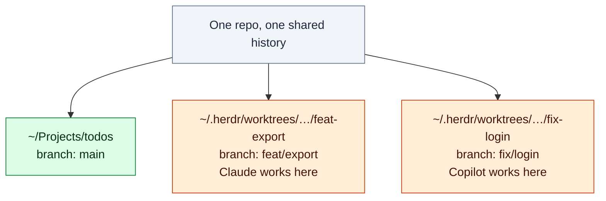
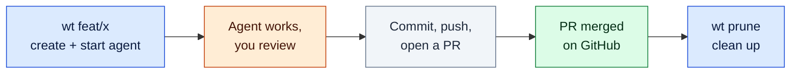

# 6. Git worktrees and `wt`

[← AI agents](05-ai-agents.md) · Next: [Secrets →](07-secrets.md)

## First, two git words

> **Branch**: a separate line of work in a repo. You make a branch, change things on it, and later **merge** it back into `main` (usually through a **pull request**, or **PR**: a request on GitHub to merge, where changes are reviewed first).
>
> **Checkout**: the files you see in the project folder. Normally a repo has **one** checkout, so you can only have one branch "open" at a time.

## What a worktree is

A **worktree** is a **second checkout** of the same repo, in another folder, on another branch. Both folders share one history, but their files are separate.



**Why you have it.** Two agents editing the same folder trample each other's files. With one agent per worktree, each works in peace, and each branch becomes its own pull request that's easy to review.

## Your helper: `wt`

`wt` creates a worktree and starts an agent in it, in one step:

```
wt <branch> [claude|copilot|gemini|none] [base]
```

- **Inside herdr:** creates the worktree (under `~/.herdr/worktrees/`), opens it as a **new workspace**, and starts the agent (Claude by default).
- **Outside herdr:** creates `../<repo>--<branch>` next to the repo, moves you there, and starts the agent.
- If the worktree already exists, it just takes you back to it.

## The life of a worktree



## The 20% you'll use

```sh
wt feat/delete-todo            # new branch + worktree + Claude
wt fix/login-bug copilot       # same, with Copilot
wt ls                          # see all worktrees and their folders
wt rm fix/login-bug            # remove one (refuses if it has unsaved work; add --force)
wt prune                       # remove every clean worktree whose branch is merged
```

**What `wt prune` removes.** It lists what it plans to do and asks before removing anything. A worktree is removed only if:
- it has no uncommitted changes, **and**
- you made at least one commit on its branch (a brand-new branch is never treated as "merged"), **and**
- the branch is merged: it's contained in `main`, or `gh` says its pull request was merged. That second check catches **squash merges**, where GitHub combines your commits into one new commit.

Inside herdr, close the leftover workspace yourself after removing a worktree.

## Try it

In a herdr pane inside a repo, run `wt try/worktree none` (`none` means "don't start an agent"). A new workspace appears in the sidebar. Run `git branch --show-current` there. To clean up: close that workspace, then `wt rm try/worktree`.

## When it breaks

- *"is already checked out"*: a branch can be open in only one worktree at a time. `wt ls` shows where.
- *"contains modified or untracked files"*: the worktree has unsaved work. Commit it, or use `wt rm <branch> --force` to throw it away.
- `wt rm` says the branch was kept: it isn't merged yet. Delete it with `git branch -D <branch>` if you're sure.

Next: [Secrets →](07-secrets.md)
