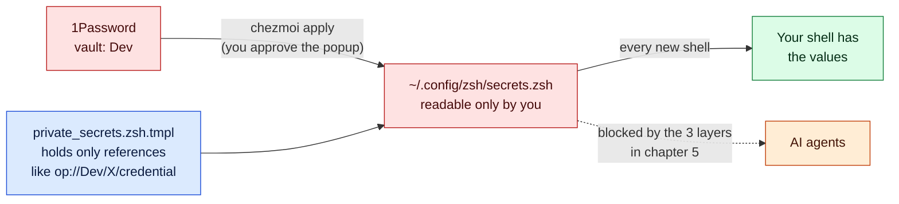
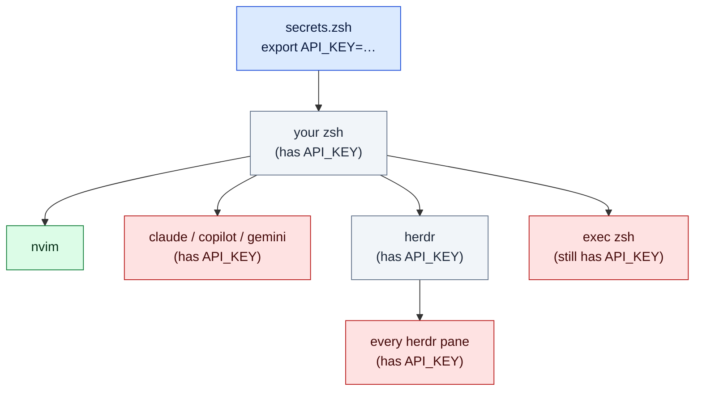

# 7. Secrets

[← Git worktrees](06-worktrees.md) · Next: [Languages and small tools →](08-languages-and-tools.md)

> **Secret**: anything that grants access: passwords, API keys, tokens, database connection strings. If it leaks, someone else can act as you.

This repo is **public on GitHub**, so secrets must never be written in it. Instead, they live in 1Password and are copied onto your Mac only when you apply.



## 1Password CLI (`op`)

**What it is.** The command-line side of your 1Password app. A **vault** is a folder of items in 1Password; your terminal secrets are in the vault called **Dev**.

**Why you have it.** Passwords and tokens used to sit in plain text in `.zshrc`. That's dangerous, especially now that AI agents read config files. Now they live in the vault, and the repo only holds **references** to them, like `op://Dev/OPENAI_API_KEY/credential`, which are safe to share.

**The 20% you'll use**
```sh
op vault list                                   # check you're connected
op item list --vault Dev                        # what's in there
op read "op://Dev/OPENAI_API_KEY/credential"   # print one secret
 op item create --vault Dev --category "API Credential" \
  --title OPENAI_API_KEY credential='sk-...'    # add one (note the leading space)
```

> **Tip:** a command that starts with a **space** isn't saved in your shell history. Use that whenever you type a secret.

**Reading a reference:** `op://Dev/OPENAI_API_KEY/credential` is **vault** / **item title** / **field**. It uses the item's *title* (the big name at the top of the item), not its "key name" field. If you're unsure, right-click the field in the 1Password app and choose **Copy Secret Reference**.

**Adding a secret to your shell (3 steps):**
1. Create it in 1Password (command above, or in the app).
2. Add a line to `home/dot_config/zsh/private_secrets.zsh.tmpl`:
   ```
   export OPENAI_API_KEY={{ onepasswordRead "op://Dev/OPENAI_API_KEY/credential" | squote }}
   ```
3. `chezmoi apply`, then open a new shell.

The rendered file, `~/.config/zsh/secrets.zsh`, is readable only by you: `ls -l` shows `-rw-------`, while ordinary files show `-rw-r--r--`. That comes from the `private_` at the start of the template's name. To check what the template *would* produce without writing anything: `chezmoi execute-template '{{ onepasswordRead "op://Dev/NAME/credential" }}'` (it prints to the screen only).

Right now the file has no secrets in it, just its comment lines, so it's ready for the first one.

**Removing a secret you no longer need (5 steps):**
1. `cze ~/.config/zsh/secrets.zsh` and **delete** the `export …` line. Save; `cze` applies it.
2. Check: `grep NAME ~/.config/zsh/secrets.zsh` prints nothing, and `git diff` shows one red line.
3. Clear it from shells that already loaded it: `unset NAME`. New windows won't have it, but `exec zsh` does: an exported variable is part of the shell's *environment*, which the new zsh inherits. (herdr panes inherit herdr's environment, so they may keep it until `herdr server stop`.)
4. Archive it in 1Password: `op item delete NAME --vault Dev --archive` (restorable from 1Password's Archive; leave off `--archive` to delete for good).
5. Make sure nothing else uses it (`rg -l NAME ~/Projects ~/Dotfiles`), then `scripts/check.sh` and commit.

Only the `op://` reference was ever in git, never the value, so there's no history to clean up.

> **Don't comment a line out, delete it.** `{{ … }}` is a template instruction, and chezmoi runs it even inside a `#` shell comment, so a commented-out line keeps calling 1Password. Git history keeps the old line if you need it back.

## Why does 1Password keep asking?

**Where the popup comes from.** While the secrets template has any `onepasswordRead` line, chezmoi has to fill those in to know what `~/.config/zsh/secrets.zsh` *should* contain. It asks the 1Password CLI, which asks the 1Password app, which asks **you** (Touch ID or your password).

| Command | Asks 1Password? |
|---|---|
| `chezmoi apply`, `chezmoi diff`, `chezmoi status`, `cze` (it applies on save) | **Yes**, while the secrets file reads from 1Password: it must build that file to compare it |
| `git diff`, `git commit`, `scripts/check.sh` | **No**: they never fill in templates |
| `op read`, `op item …` | **Yes**: that's `op` itself |

With no secrets in the file (as now), chezmoi never asks.

**Why only "once in a while".** After you approve, 1Password trusts that terminal for a while:
- **Per terminal tab:** a new Ghostty tab or herdr pane asks again.
- **It expires** after about 10 minutes of not using `op`, with a hard limit of about 12 hours.
- **Locking 1Password** or your Mac ends every session.

**Making it ask less:**
- **Accept it.** One tap means no secret ever sits in the repo, and nothing (AI agents included) can read your vault without you noticing.
- **Target one file:** `chezmoi apply ~/.config/aerospace/aerospace.toml`, or `chezmoi diff ~/.config/ghostty/config`. chezmoi then usually only fills in the templates it needs.
- **Stay in one tab** for a session of dotfiles work.
- **Don't** turn off 1Password's CLI integration or copy secrets into the repo: either removes the protection.

If the popup appears on a command that shouldn't need it (`git`, `check.sh`), something is calling `op` that shouldn't be: worth investigating.

## Who can see a secret in your shell?

**The short version:** a secret you `export` is handed to **every program you start from that shell**, including AI agents. So the fewer secrets your shell carries, and the shorter the time, the better.

**How it works.** Every running program has an **environment**: a list of named values (`HOME`, `PATH`, `EDITOR`…) that it can read. When one program starts another, the new one gets a **copy** of that list. `export` adds a value to the list. So:



Every box under your shell got its own copy. `unset API_KEY` removes it from *this* shell only, not from copies already handed out.

**What can actually see it:**

| Who | Can see your shell's secrets? | Why |
|---|---|---|
| Programs you start from that shell, **including AI agents** | **Yes** | They inherit the environment. An agent running `env` sees everything. The guard hook stops agents reading `secrets.zsh`, but it can't take away what they inherited. |
| herdr panes | **Yes**, until `herdr server stop` | Panes inherit herdr's environment, from whichever shell started herdr. |
| Tools that print or log their environment (some crash reports, debug modes) | Sometimes | Whatever they log can end up in a file or a bug report. |
| Anyone watching your screen when you run `env` | Yes | Avoid `env` / `printenv` while screen-sharing. |
| Other user accounts on the Mac, other people on your network | **No** | Only programs running as *you* can read your programs' environments. |

**Rules of thumb**, best first:

1. **Give a secret to one command, not to the shell.** 1Password's `op run` fetches the secrets, runs one command with them, and that's it: your shell and your agents never get them. Put the references (never the values) in a file, then run the command through `op run`:
   ```sh
   # .env.op   (safe to commit: references only)
   API_KEY=op://Dev/X/credential
   ```
   ```sh
   op run --env-file .env.op -- npm run deploy
   ```
   As a bonus, `op run` hides the secret's value (`<concealed by 1Password>`) if the command ever prints it.
2. **For one project, use direnv** (next section): the secret is there only while you're inside that project's folder.
3. **Keep `secrets.zsh` for secrets that really must be everywhere.** Ideally it stays empty, as it is now.
4. **Starting an agent?** Do it in a shell that never loaded secrets. If you `unset` something or removed it from `secrets.zsh`, open a **new** terminal tab (not `exec zsh`) before starting the agent.

## Secrets for one project: direnv

For a key only one project needs, use **direnv** instead of your global shell. It loads a folder's `.envrc` file when you `cd` in, and unloads it when you leave:
```sh
cd ~/Projects/some-project
echo 'export API_KEY=$(op read op://Dev/X/credential)' > .envrc
direnv allow
```
The `.envrc` file holds only the reference, not the secret.

## The safety net: gitleaks

**gitleaks** scans for things that look like secrets. A **pre-commit hook** (a script git runs just before every commit) runs it in `~/Dotfiles` and **refuses the commit** if it finds one. `scripts/check.sh` runs it over the whole history too. Never skip it with `git commit --no-verify`.

Scan any other repo with `gitleaks git`.

## When it breaks

- **1Password errors during `chezmoi apply`**: unlock the 1Password app, then check `op vault list` shows **Dev**. In the app, **Settings → Developer → Integrate with 1Password CLI** must be on.
- **A new secret isn't in your shell**: did you `chezmoi apply` and open a **new** shell?
- **`"NAME" isn't an item in the "Dev" vault`**: the reference doesn't match the item's title (often still the default, like "API Credential"), or the item is in another vault. `op item list --vault Dev` lists the titles.
- **gitleaks blocks a commit**: it found something that looks like a secret. Remove it from the staged files (`git restore --staged <file>`), move the value to 1Password, and reference it instead.

Next: [Languages and small tools →](08-languages-and-tools.md)
