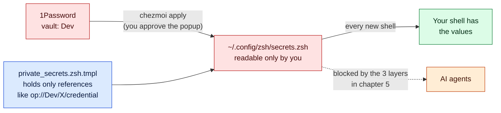

# 7. Secrets

[← Git worktrees](06-worktrees.md) · Next: [Languages and small tools →](08-languages-and-tools.md)

> **Secret**: anything that grants access: passwords, API keys, tokens, database connection strings. If it leaks, someone else can act as you.

This repo is **public on GitHub**, so secrets must never be written in it. Instead, they live in 1Password and are copied onto your Mac only when you apply.



## 1Password CLI (`op`)

**What it is.** The command-line side of your 1Password app. A **vault** is a folder of items in 1Password; your terminal secrets are in the vault called **Dev**.

**Why you have it.** Passwords and tokens used to sit in plain text in `.zshrc`. That's dangerous, especially now that AI agents read config files. Now they live in the vault, and the repo only holds **references** to them, like `op://Dev/GENAI_DB_DSN/credential`, which are safe to share.

**The 20% you'll use**
```sh
op vault list                                   # check you're connected
op item list --vault Dev                        # what's in there
op read "op://Dev/GENAI_DB_DSN/credential"      # print one secret
 op item create --vault Dev --category "API Credential" \
  --title OPENAI_API_KEY credential='sk-...'    # add one (note the leading space)
```

> **Tip:** a command that starts with a **space** isn't saved in your shell history. Use that whenever you type a secret.

**Adding a secret to your shell (3 steps):**
1. Create it in 1Password (command above, or in the app).
2. Add a line to `home/dot_config/zsh/private_secrets.zsh.tmpl`:
   ```
   export OPENAI_API_KEY={{ onepasswordRead "op://Dev/OPENAI_API_KEY/credential" | squote }}
   ```
3. `chezmoi apply`, then open a new shell.

## Secrets for one project: direnv

For a key only one project needs, use **direnv** instead of your global shell. It loads a folder's `.envrc` file when you `cd` in, and unloads it when you leave:
```sh
cd ~/Projects/some-project
echo 'export API_KEY=$(op read op://Dev/X/credential)' > .envrc
direnv allow
```
The `.envrc` file holds only the reference, not the secret.

## The safety net: gitleaks

**gitleaks** scans for things that look like secrets. A **pre-commit hook** (a script git runs just before every commit) runs it in `~/Dotfiles` and **refuses the commit** if it finds one. `scripts/check.sh` runs it over the whole history too. Never skip it with `git commit --no-verify`.

Scan any other repo with `gitleaks git`.

## When it breaks

- **1Password errors during `chezmoi apply`**: unlock the 1Password app, then check `op vault list` shows **Dev**. In the app, **Settings → Developer → Integrate with 1Password CLI** must be on.
- **A new secret isn't in your shell**: did you `chezmoi apply` and open a **new** shell?
- **gitleaks blocks a commit**: it found something that looks like a secret. Remove it from the staged files (`git restore --staged <file>`), move the value to 1Password, and reference it instead.

Next: [Languages and small tools →](08-languages-and-tools.md)
