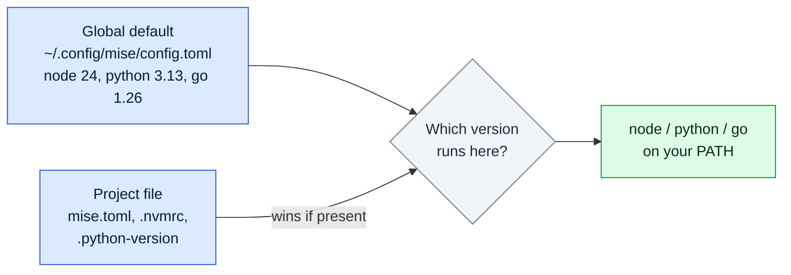

# 8. Languages and small tools

[← Secrets](07-secrets.md) · Next: [Windows, keyboard and phone →](09-desktop.md)

## mise: language versions

> **Runtime**: the program that runs code in a language: `node` for JavaScript, `python`, `go`. Different projects often need different versions.

**What it is.** One tool that installs and switches versions of node, python, go and more. It replaced nvm, pyenv and asdf.

**Why you have it.** One tool instead of three, faster shells, and AI agents get the **same** versions you do.



**PHP is the exception**: it comes from **Laravel Herd**, not mise.

**The 20% you'll use**
```sh
mise ls                     # what's installed and active here
mise use node@22            # pin node 22 for THIS project (writes mise.toml)
mise install                # install whatever this folder asks for
mise upgrade                # update installed tools
mise trust                  # allow a project's mise.toml (asked the first time)
mise doctor                 # health check
```
mise also reads `.nvmrc`, `.python-version` and `.go-version` files, so older projects keep working.

To change a **global** version, edit `home/dot_config/mise/config.toml` and run `chezmoi apply`; it installs the new version for you. Don't use `mise use -g`: it edits the copy in `~`, and the next apply overwrites it.

**Try it.** `mkdir /tmp/mise-try && cd /tmp/mise-try && mise use node@22 && node -v && cd ~ && node -v`. The version changes when you leave the folder. Clean up: `rm -rf /tmp/mise-try`.

**When it breaks**
- Wrong version: `mise doctor`; `which node` should point into `~/.local/share/mise/`.
- Python projects: use **uv** (`uv sync`, `uv run pytest`). It uses mise's Python.

## Small tools that make agents better

| Tool | What it is | The one thing to know |
|---|---|---|
| **direnv** | Loads a folder's `.envrc` when you `cd` in | See [chapter 7](07-secrets.md#secrets-for-one-project-direnv) |
| **delta** | Prettier diffs for `git diff` and `chezmoi diff`: colours and line numbers instead of `+`/`-` | Automatic. Red = removed, green = added ([how to read one](02-chezmoi-basics.md#reading-chezmoi-diff)). In a diff, `n`/`N` jump between files. |
| **lazygit** | Git in a full-screen interface | `lazygit` (or `Ctrl+B` `Alt+G` in herdr). `space` stage, `c` commit, `P` push, `?` help. Great for reviewing what an agent changed. |
| **gitleaks** | Secret scanner | See [chapter 7](07-secrets.md#the-safety-net-gitleaks) |
| **gh** | GitHub from the terminal | `gh pr create`, `gh pr checkout 12`, `gh run watch`. Agents use it too. |
| **zoxide** | Smart `cd` that learns where you go | `z go-todos` jumps to the best match. |
| **fzf** | Fuzzy picker: type a few letters to filter a list | Used by `tt`, `fav`, `cdf`, `sshf`, `notes`. |
| **ripgrep** (`rg`), **fd** | Fast search inside files, and for file names | Agents prefer them; so should you. |
| **shellcheck**, **stylua** | Checkers for shell scripts and Lua files | `scripts/check.sh` runs both. |

## Your shell shortcuts

| Command | Does |
|---|---|
| `?? <question>` | Quick answer from Copilot; runs nothing. `?? find files bigger than 1GB` |
| `wt <branch>` | Worktree + agent ([chapter 6](06-worktrees.md)) |
| `agents-init` | Write an `AGENTS.md` for the current project ([chapter 5](05-ai-agents.md#project-level-instructions-agentsmd)) |
| `tt` | Open a project as a herdr workspace |
| `updater` | Menu to update dotfiles, Homebrew, mise, agent CLIs, herdr, zsh plugins |
| `notes …` / `nt`, `note`, `omn`, `ns`, `on`, `bs` | Your notes workflow (`notes --help`) |
| `Esc` then `v` | Edit the current command in Neovim. Great for long prompts. |
| `dot`, `pro`, `fav`, `cdf` | Jump to dotfiles / projects / favourites / a subfolder |
| `trash <file>` | Move to `~/.shell/trash` instead of deleting |

Next: [Windows, keyboard and phone →](09-desktop.md)
