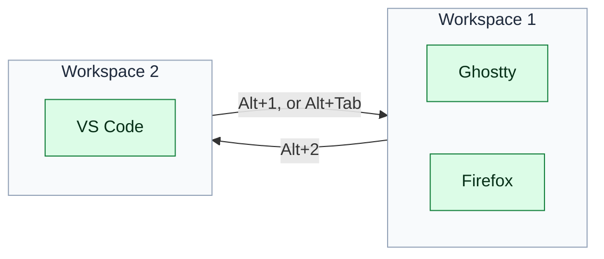
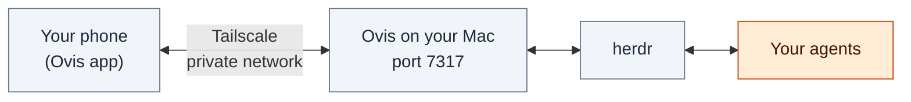

# 9. Windows, keyboard and phone

[← Languages and small tools](08-languages-and-tools.md) · Next: [A day with this setup →](10-daily-workflow.md)

## AeroSpace: window tiling

**What it is.** A **tiling window manager**: it arranges the windows on a screen side by side automatically, with no dragging or resizing by hand. It replaced yabai, skhd and sketchybar.

**Why you have it.** Ghostty on one side and a browser or VS Code on the other, every time, without touching the mouse.

**Words.** An AeroSpace **workspace** is like a macOS Space (a virtual desktop), but instant to switch to and named: `1`–`9`, `A`–`Z`. `Alt` is the `Option` key.

**The 20% you'll use**

| Action | Keys |
|---|---|
| **New Ghostty window** | `Alt+Enter` |
| **Make this window fill the screen** (press again to go back) | `Alt+Shift+Enter` |
| Focus window left/down/up/right | `Alt+H` `Alt+J` `Alt+K` `Alt+L` |
| Move window left/down/up/right | `Alt+Shift+H/J/K/L` |
| Go to workspace 1–9 / A–Z | `Alt+1` … `Alt+9`, `Alt+<letter>` |
| Send window to workspace | `Alt+Shift+1` … / `Alt+Shift+<letter>` |
| Previous workspace (toggle) | `Alt+Tab` |
| Side by side ↔ stacked | `Alt+/` ↔ `Alt+,` |
| Make window smaller / bigger | `Alt+-` / `Alt+=` |
| **Make all windows equal size again** | `Alt+Shift+=` |
| Service mode (then `Esc` reloads config) | `Alt+Shift+;` |

**A simple habit:** `1` = terminal, `2` = browser, `3` = VS Code, `4` = chat and mail. Send each app there once with `Alt+Shift+<n>`.

**Try it.** Open Ghostty and Firefox on workspace 1. They split the screen. Press `Alt+H` and `Alt+L` to switch between them, `Alt+Shift+L` to swap them, then `Alt+Shift+2` to send Firefox to workspace 2 and `Alt+2` to follow it.

**Changing its settings:** `home/dot_config/aerospace/aerospace.toml` (lane 1). [Chapter 2](02-chezmoi-basics.md#worked-example-change-a-setting-end-to-end) walks through a full change using this file as the example.

**When it breaks**
- Keys do nothing: grant **Accessibility** permission (System Settings → Privacy & Security → Accessibility → AeroSpace).
- A window shouldn't tile (e.g. a dialog): it floats automatically for System Settings, 1Password and Karabiner. To add more, add an `[[on-window-detected]]` rule to `aerospace.toml`.
- Run `~/Dotfiles/scripts/macos-defaults.sh` once. It sets the Mission Control options AeroSpace recommends (log out and back in afterwards).
- **Conflict note:** `Alt+H/J/K/L` belong to AeroSpace everywhere. In Neovim, switch windows with the arrow keys or `Ctrl+W h/j/k/l`.

## Karabiner and Hammerspoon

- **Karabiner-Elements** changes what keys do. Caps Lock = `Esc` when tapped, `Ctrl` when held. `Ctrl+H/J/K/L` = arrow keys. Its config is in lane 2 (`config/karabiner/`): change it in the Karabiner app and the change shows up in `git diff`.
- **Hammerspoon** runs small Lua scripts that automate macOS. Yours shows a green bar while Korean input is active, and switches to English when you press `Esc` in Vim. Config: `home/dot_hammerspoon/` (lane 1). Reload it from its menu-bar icon → Reload Config.

## Tailscale + Ovis: your agents on your phone

**What they are.**
- **Tailscale** creates a **private network** between your own devices (Mac, phone), wherever they are. Nothing is exposed to the public internet.
- **Ovis** is a web app running on your Mac, on top of herdr. It shows your agents as chats and turns their approval prompts into **Allow / Deny** buttons, with push alerts.

**Why you have them.** Start a long task, walk away, and approve the `git push` from your phone.

**How it's wired:** Ovis listens on `http://127.0.0.1:7317`, which only your Mac can reach. `tailscale serve` publishes it as an HTTPS address that **only your Tailscale devices** can open. Find the address with `tailscale serve status`.

**Daily use**
1. Ovis starts with herdr. Make sure herdr is running (`herdr`, then detach).
2. On your phone: Tailscale **Connected**, then open Ovis from your home screen.
3. When an agent is **blocked** (waiting for you), you get an alert. Tap **Allow** or **Deny**.

**When it breaks**
- Phone can't load it: is Tailscale connected on **both** devices (`tailscale status`)? Is herdr running (`herdr status server`)?
- No alerts: in Ovis, **Settings → Alerts → Send test**.
- Updating Ovis: rerun its installer with Homebrew's curl, because macOS's built-in curl trips an installer bug:
  `curl -fsSL https://ovis.sh/install.sh | PATH="/opt/homebrew/opt/curl/bin:$PATH" sh`

Next: [A day with this setup →](10-daily-workflow.md)
