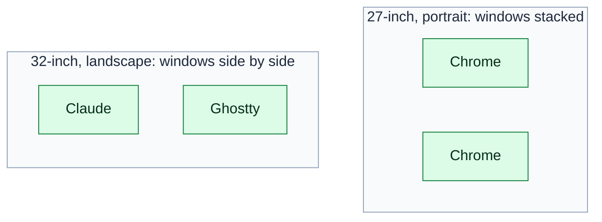
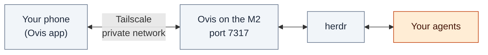

# 9. Windows, keyboard and phone

[← Languages and small tools](08-languages-and-tools.md) · Next: [A day with this setup →](10-daily-workflow.md)

Everything in this chapter except the phone part is **on the M2 only**: the Ubuntu spares use Ubuntu's own desktop, with no AeroSpace, Karabiner or Hammerspoon ([chapter 14](14-spare-linux.md)).

## AeroSpace: window tiling

**What it is.** A **tiling window manager**: it arranges the windows on a screen side by side automatically, with no dragging or resizing by hand. It replaced yabai, skhd and sketchybar.

**Why you have it.** Ghostty on one side and a browser or VS Code on the other, every time, without touching the mouse.

**Words.** An AeroSpace **workspace** is like a macOS Space (a virtual desktop), but instant to switch to and named: `1`–`9`, `A`–`Z`. `Alt` is the `Option` key.



Each monitor shows **one** workspace at a time. Here the 32-inch shows `T` (Claude and Ghostty) and the 27-inch shows `B` (two Chrome windows). Any workspace can go on either monitor.

**The 20% you'll use**

| Action | Keys |
|---|---|
| **New Ghostty window** | `Alt+Enter` (a new window in the running Ghostty, so there's one Dock icon) |
| **Make this window fill the screen** (press again to go back) | `Alt+Shift+Enter` |
| Focus window left/down/up/right | `Alt+H` `Alt+J` `Alt+K` `Alt+L` |
| Move window left/down/up/right (swaps places with its neighbour) | `Alt+Shift+H/J/K/L` |
| Go to workspace 1–9 / A–Z | `Alt+1` … `Alt+9`, `Alt+<letter>` |
| Send window to workspace | `Alt+Shift+1` … / `Alt+Shift+<letter>` |
| Previous workspace (toggle) | `Alt+Tab` |
| Side by side ↔ stacked | `Alt+/` ↔ `Alt+,` |
| Make window smaller / bigger | `Alt+-` / `Alt+=` |
| **Make all windows equal size again** | `Alt+Shift+=` |
| Service mode, then: `Esc` reload config · `f` float ↔ tile this window · `r` reset the layout | `Alt+Shift+;` |

### Your workspaces: one letter per job

Workspaces are named with **letters you can remember**, and most apps open on their own letter automatically.

| Key | Mnemonic | Opens there automatically |
|---|---|---|
| **`T`** | **T**erminal | Claude desktop (open Ghostty here; it sits beside Claude) |
| **`C`** | **C**ode | VS Code |
| **`D`** | **D**ata | DBeaver, Beekeeper Studio, Docker Desktop |
| **`B`** | **B**rowser | Chrome **Personal** profile, Firefox |
| **`W`** | **W**ork | Chrome **Work** profile, Microsoft Teams |
| **`R`** | **R**eading | nothing automatic: send docs and PDFs here |
| **`M`** | **M**essages | Mail, Messages, Slack, KakaoTalk |
| **`Z`** | **Z**oom | Zoom (floating, not tiled) |
| **`N`** | **N**otes | Apple Notes |
| `1`–`9` | scratch | nothing: use for anything temporary |

**Workspaces aren't tied to a monitor.** Any workspace can show on either one:

- **Go** to a workspace: `Alt+<letter>`. It appears on the monitor you're focused on. If it's already showing on the *other* monitor, your focus jumps there instead.
- **Send** the current window to a workspace: `Alt+Shift+<letter>`.
- **Move the whole workspace** to the other monitor: `Alt+Shift+Tab`. Handy for putting the browser, or a Zoom call, on the big screen for a while.
- **Switch focus between monitors:** keep pressing `Alt+H` / `Alt+L`. At the edge of one monitor, focus carries on to the next, in the direction the monitors are arranged in System Settings → Displays.

A layout that works well: `T` on the 32-inch, `B` or `W` on the 27-inch.

**The portrait 27-inch.** Your config sets `default-root-container-orientation = 'auto'`: on a wide monitor, windows sit side by side; on a tall one, they **stack top and bottom**. So the same workspace looks different depending on which monitor shows it. `Alt+/` flips between side by side and stacked if you want the other arrangement.

- **One Ghostty in the Dock.** `Alt+Enter` asks the running Ghostty for a new window (through its AppleScript support, Ghostty 1.3+), so every terminal window belongs to one app. Opening a separate copy of the app each time, as `open -n` did, added a Dock icon per window. The first time, macOS asks whether AeroSpace may control Ghostty: allow it (System Settings → Privacy & Security → Automation, if you need to change it later).
- **Ghostty has no automatic rule** on purpose. `Alt+Enter` opens a new terminal *where you are*; with a rule, every new terminal would jump to `T`.
- **Work and personal stay apart.** `W` holds everything for work (Work Chrome, Teams); `B` and `M` are personal. A Teams **call** opens in its own window on `W`; to take it full screen on the big monitor, send it to `Z` with `Alt+Shift+Z`, then move `Z` over with `Alt+Shift+Tab`.
- **Chrome's two profiles** are told apart by the end of the window title: `(Work)` goes to `W`, everything else to `B`. Chrome sometimes sets the title a moment after the window appears, so a Work window occasionally lands on `B`: press `Alt+Shift+W`.
- **Adding an app:** run `aerospace list-apps` to find its **bundle ID** (the unique name macOS gives each app, like `com.google.Chrome`), then copy one of the `[[on-window-detected]]` rules in `aerospace.toml`. Rules are checked top to bottom and the first match wins.

### Focus border

The focused window gets a **thick crimson outline**, so you can always tell which window your keys will go to, even across two monitors. Unfocused windows get no outline.

It's drawn by **JankyBorders** (the `borders` command), a small separate program; AeroSpace can't draw borders itself. AeroSpace starts it, through this line near the top of `aerospace.toml`:

```toml
after-startup-command = [
  'exec-and-forget borders active_color=0xffd7263d inactive_color=0x00000000 width=12.0',
]
```

| Setting | Means | Yours |
|---|---|---|
| `active_color` | Outline of the focused window, as `0xAARRGGBB`: `AA` is opacity (`ff` solid, `00` invisible), then red, green, blue | `0xffd7263d`: solid crimson |
| `inactive_color` | Outline of the other windows | `0x00000000`: none |
| `width` | Thickness in points | `12.0`: bold |

**Choosing a colour:** pale colours (like the soft green this started with, `0xff8fbf7f`) vanish against light-mode windows; deeper, saturated ones show on both light and dark. Some tried on 2026-11-19: `0xffe67e80` soft rose, `0xffff6b6b` coral, `0xfffb4934` gruvbox red, `0xfffe8019` gruvbox orange, `0xffd7263d` crimson (chosen, with width 12).

**To change it:** try a value live first. `borders width=6.0` or `borders active_color=0xff7fafdf` changes the running border straight away without touching any file, like Ghostty's `Cmd+-`. Then make it permanent with `cze ~/.config/aerospace/aerospace.toml`.

**A permanent change needs an AeroSpace restart.** `after-startup-command` runs only when AeroSpace **starts**, so `aerospace reload-config` isn't enough: click the AeroSpace menu-bar icon → **Quit AeroSpace**, then `open -a AeroSpace`.

**To remove it:** delete the `after-startup-command` lines (leave `after-startup-command = []`), and the `tap "FelixKratz/formulae"` and `brew "borders"` lines from the Brewfile; apply, restart AeroSpace, and `brew uninstall borders`.

**Try it.** Open Ghostty and Firefox on workspace 1. They split the screen. Press `Alt+H` and `Alt+L` to switch between them, `Alt+Shift+L` to swap them, then `Alt+Shift+2` to send Firefox to workspace 2 and `Alt+2` to follow it.

**Changing its settings:** `home/dot_config/aerospace/aerospace.toml` (lane 1). [Chapter 2](02-chezmoi-basics.md#worked-example-change-a-setting-end-to-end) walks through a full change using this file as the example.

**When it breaks**
- **Empty gaps where windows should be.** Some windows are in a *different macOS Space*: either a window in macOS **native full screen** (the green button, or `Ctrl+Cmd+F`), or a window on a second macOS Desktop. AeroSpace still reserves room for them. Fix: open Mission Control (`Ctrl+↑`), take full-screen windows out of full screen with `Ctrl+Cmd+F`, and remove extra Desktops with the **×** on their thumbnails. Keep **one macOS Desktop per monitor**, and use `Alt+Shift+Enter` for full screen instead. `aerospace list-windows --workspace focused` shows every window AeroSpace thinks is on the current workspace.
- **A window won't tile, and `Alt+/` does nothing.** The window is **floating**: AeroSpace floats windows it takes for dialogs or popups (Chrome's profile picker, for example), and a floating window isn't part of the tiles, so layout keys don't affect it. Check with `aerospace list-windows --workspace focused --format '%{app-name} | %{window-layout}'`: `floating` is the culprit, `h_tiles`/`v_tiles` are fine. Fix: click it, then `Alt+Shift+;` then `f`. If one app's windows *always* float, add `'layout tiling'` to its rule: `run = ['layout tiling', 'move-node-to-workspace W']`.
- **A strange, nested layout.** On that workspace, `Alt+Shift+;` then `r` flattens it back to simple tiles.
- An app opens on the wrong workspace: check its bundle ID with `aerospace list-apps` against the rules in `aerospace.toml`. An app with no rule opens wherever you are.
- **No border.** Is it running? `pgrep -l borders`. If not, restart AeroSpace (see [Focus border](#focus-border)). JankyBorders draws with private macOS interfaces, so a big macOS update can stop it until a fix ships: `brew upgrade borders`.
- Keys do nothing: grant **Accessibility** permission (System Settings → Privacy & Security → Accessibility → AeroSpace).
- **A floating window hangs off the edge of the portrait monitor** (1Password, for example): AeroSpace doesn't size floating windows; the app reopens at the size it last had, often set on the wide monitor. Drag it to fit once on the portrait monitor; the app remembers.
- A window shouldn't tile (e.g. a dialog): it floats automatically for System Settings, 1Password and Karabiner. To add more, add an `[[on-window-detected]]` rule to `aerospace.toml`.
- Run `~/Dotfiles/scripts/macos-defaults.sh` once. It sets the Mission Control options AeroSpace recommends (log out and back in afterwards).
- **Conflict note:** `Alt+H/J/K/L` belong to AeroSpace everywhere. In Neovim, switch windows with the arrow keys or `Ctrl+W h/j/k/l`.

## Karabiner and Hammerspoon

- **Karabiner-Elements** changes what keys do. Its config is in lane 2 (`config/karabiner/`): change it in the Karabiner app and the change shows up in `git diff`. Your remaps:

  | Key | Becomes | Why |
  |---|---|---|
  | Caps Lock | `Esc` when tapped, `Ctrl` when held | Esc for Vim, Ctrl without reaching for the corner |
  | Right `Cmd` | Right `Option` (= `Alt`) | AeroSpace's `Alt` key under your right thumb |
  | `Ctrl+H/J/K/L` | Arrow keys | arrows on the home row, in every app |

  Left `Cmd` is untouched, so `Cmd+C`, `Cmd+Tab` and friends work as usual. Ghostty sends `Option` to the terminal as `Alt` (`macos-option-as-alt = true` in its config), so `Alt` shortcuts in herdr and the shell work too. Because `Ctrl+H/J/K/L` turn into arrows before any app sees them, Neovim can't use those keys (or `Ctrl+K`), which is why its windows are switched with the arrow keys.
  To see what Karabiner sends, open **Karabiner-EventViewer** and press keys: it shows them *after* remapping.

  On the Ubuntu spares, **keyd** gives you the Caps Lock part (tap = Esc, hold = Ctrl, Caps+h/j/k/l = arrows) ([chapter 14](14-spare-linux.md#keyboard-caps-lock-as-on-the-m2)).
- **Hammerspoon** runs small Lua scripts that automate macOS. Yours shows a green bar while Korean input is active, and switches to English when you press `Esc` in Vim. Config: `home/dot_hammerspoon/` (lane 1). Reload it from its menu-bar icon → Reload Config.

## Tailscale + Ovis: your agents on your phone

**What they are.**
- **Tailscale** creates a **private network** between your own devices (the M2, the Ubuntu spares, your phone), wherever they are. Nothing is exposed to the public internet.
- **Ovis** is a web app running on the M2, on top of herdr. It shows your agents as chats and turns their approval prompts into **Allow / Deny** buttons, with push alerts.

**Why you have them.** Start a long task, walk away, and approve the `git push` from your phone.



**How it's wired:** Ovis listens on `http://127.0.0.1:7317`, which only the M2 itself can reach. `tailscale serve` publishes it as an HTTPS address that **only your Tailscale devices** can open. Find the address with `tailscale serve status`.

**Daily use**
1. Ovis starts with herdr. Make sure herdr is running (`herdr`, then detach).
2. On your phone: Tailscale **Connected**, then open Ovis from your home screen.
3. When an agent is **blocked** (waiting for you), you get an alert. Tap **Allow** or **Deny**.

**When it breaks**
- Phone can't load it: is Tailscale connected on **both** devices (`tailscale status`)? Is herdr running (`herdr status server`)?
- No alerts: in Ovis, **Settings → Alerts → Send test**.
- Updating Ovis: rerun its installer with Homebrew's curl, because macOS's built-in curl trips an installer bug:
  `curl -fsSL https://ovis.sh/install.sh | PATH="/opt/homebrew/opt/curl/bin:$PATH" sh`

**Other phone apps.** herdr has an official phone app, and there are independent ones (Sherpr, Mussh…). They connect over SSH. The official one needs **herdr-core**, which comes with the Herdr *desktop* app, not the terminal version you use; it offers to install it when you connect, so decline. Ovis (agents) plus Termux (a full terminal, [chapter 12](12-notes.md#editing-from-your-android-phone)) already cover both jobs. If you try an independent app, give it its own SSH key so you can remove it alone.

Next: [A day with this setup →](10-daily-workflow.md)
