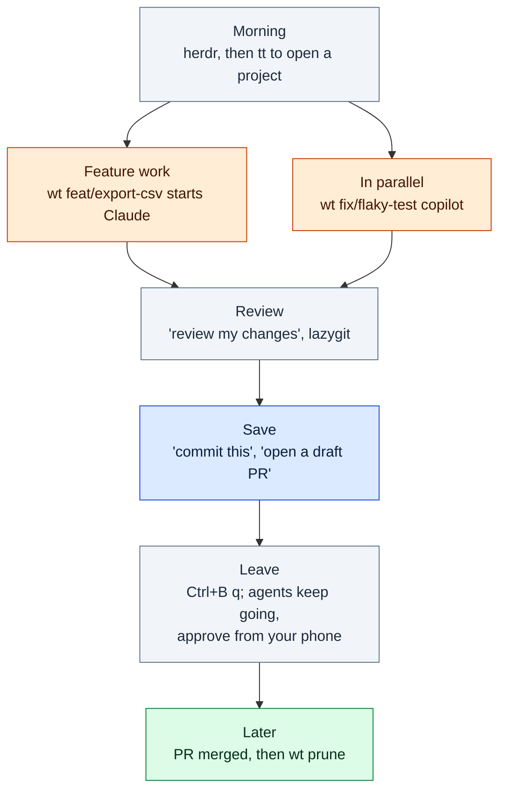

# 10. A day with this setup

[← Windows, keyboard and phone](09-desktop.md) · [Back to start](README.md)

## A typical day



The same day as commands:

```sh
# Morning
herdr                         # open Ghostty, then herdr
tt                            # pick a project → new workspace

# Feature work
wt feat/export-csv            # worktree + Claude in a new workspace
# > "Add CSV export to /todos. Plan first."   (Shift+Tab for plan mode)
# > "Looks good, implement it. Done = go test ./... passes."
# …meanwhile, in another workspace…
wt fix/flaky-test copilot     # second agent, second branch

# Review
# > "review my changes"       (code-review skill)
#   Ctrl+B Alt+G → lazygit    look at the diff yourself
# > "commit this"             (commit skill; asks before committing)
# > "open a draft PR"         (pr-description skill; asks before pushing)

# Leaving
#   Ctrl+B q                  detach; agents keep going
#   phone: approve/deny via Ovis alerts

# After the PRs are merged
wt prune                      # remove finished worktrees
```

## Four-week learning plan

Spend about **20 minutes a day**. Don't move on until the current week's tools feel normal.

**Week 1: terminal + one agent**
- [ ] [Chapter 1](01-big-picture.md): read it once.
- [ ] [Chapter 4](04-terminal.md): Ghostty's Shift+Enter; herdr's "Try it", especially detach and reconnect.
- [ ] [Chapter 5](05-ai-agents.md): Claude Code only, one small real task per day.
- [ ] Learn: `Esc`, `Esc Esc`, `Shift+Tab`, `/clear`, `@file`.

**Week 2: safety + git flow**
- [ ] [Chapter 5](05-ai-agents.md) again: notice what runs without asking and what asks. Read `agents.yaml`.
- [ ] [Chapter 6](06-worktrees.md): one feature per `wt` branch, and `wt prune` after merging.
- [ ] lazygit for reviewing ([chapter 8](08-languages-and-tools.md)); let the agent write commits with the `commit` skill.
- [ ] Try `copilot` for one task, and `/review` on your own diff.

**Week 3: your environment**
- [ ] [Chapter 2](02-chezmoi-basics.md): do the alias exercise, then change one real thing.
- [ ] [Chapter 3](03-how-files-are-made.md): add one command to `allowCommands`, run `scripts/check.sh`, apply.
- [ ] [Chapter 7](07-secrets.md): add one secret the right way.
- [ ] [Chapter 8](08-languages-and-tools.md): pin a version in one project with mise.
- [ ] [Chapter 9](09-desktop.md): one AeroSpace workspace per app, all week.

**Week 4: parallel + remote**
- [ ] Two agents in parallel on two `wt` branches.
- [ ] [Chapter 9](09-desktop.md): approve something from your phone with Ovis.
- [ ] Run `agents-init` in your most-used project and fill in its `AGENTS.md`.
- [ ] Write your **own** skill: copy a folder in `home/dot_agents/skills/`, edit its `SKILL.md`, then `chezmoi apply`.

## When you're stuck

1. **Ask an agent.** Run `claude` in `~/Dotfiles`. It reads this repo's `AGENTS.md` and knows how everything fits together, so "why does X…?" works well. Point it at a chapter: "read @docs/04-terminal.md and help me with herdr".
2. **Health checks:** `chezmoi doctor`, `mise doctor`, `herdr status`, `tailscale status`, `op vault list`, `scripts/check.sh`.
3. **Undo:** the repo is in git, so `git log` shows every change and `git checkout -- <file>` undoes an uncommitted one. A full backup of the old setup is at `~/Backups/dotfiles-2026-11-14.tar.gz`.
4. **Look a word up** in the [glossary](glossary.md).
5. **Official docs:** [herdr](https://herdr.dev/docs/) · [chezmoi](https://chezmoi.io/user-guide/command-overview/) · [mise](https://mise.jdx.dev/getting-started.html) · [AeroSpace](https://nikitabobko.github.io/AeroSpace/guide) · [Ghostty](https://ghostty.org/docs) · [Claude Code](https://docs.anthropic.com/en/docs/claude-code) · [Copilot CLI](https://docs.github.com/copilot/how-tos/use-copilot-agents/use-copilot-cli) · [Gemini CLI](https://geminicli.com/docs/) · [Ovis](https://github.com/devswha/ovis/blob/main/docs/guide.md)
