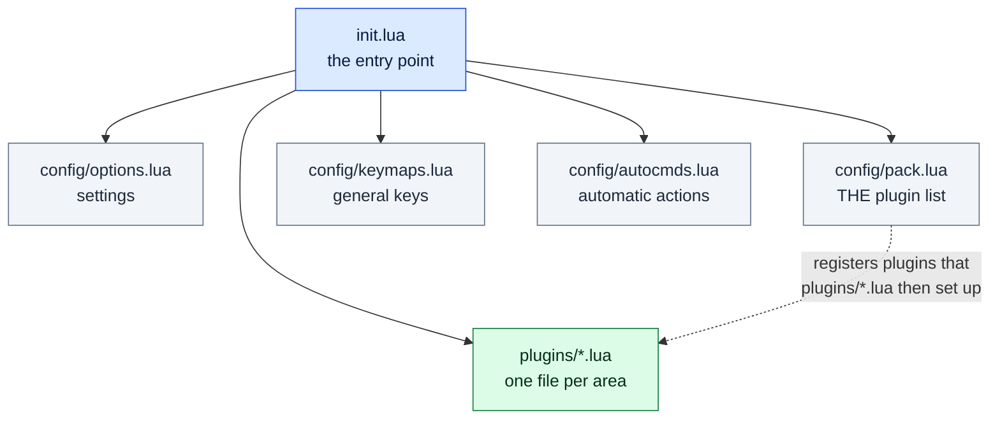

# 11. Neovim: the lean config

[← A day with this setup](10-daily-workflow.md) · [Back to start](README.md)

This chapter explains your Neovim config in `config/nvim-lean/`: what's in it, why, and how to change it yourself. It's written so you can own every line.

> **Neovim** is the editor. A **config** is the Lua code it runs at startup to set options, keys and plugins. A **plugin** is someone else's Lua code that adds a feature (a file tree, a fuzzy finder).

## The idea

Neovim 0.12 (released March 2026) builds in a lot that used to need plugins: a **plugin manager** (`vim.pack`), **language-server support** (go to definition, rename, errors as you type), **Copilot-style suggestions**, an **undo tree** and better messages. So this config is a thin layer: Neovim's built-ins, plus about a dozen plugins for what's still missing. The old LazyVim setup had 58.

> **Language server** (LSP): a separate program that understands one language (`gopls` for Go, `intelephense` for PHP) and tells the editor about errors, definitions and completions. **Tree-sitter**: a fast parser that understands code structure, used for syntax colours and indentation.

## Trying it next to LazyVim

Both configs live side by side. `NVIM_APPNAME` tells Neovim which config folder to use, and each gets its own plugins and data:

| Command | Runs | Config folder |
|---|---|---|
| `nvim` | your current LazyVim setup | `~/.config/nvim` → `config/nvim/` |
| `vl` | the lean config | `~/.config/nvim-lean` → `config/nvim-lean/` |

Both folders are **linked** (lane 2): edit either side, no `chezmoi apply`.

**First start (`vl`):** `vim.pack` asks to install the plugins (answer yes), blink.cmp downloads its fuzzy matcher, and nvim-treesitter builds about 40 parsers in the background (a minute or two). Restart once everything's done. After that, starts are fast.

**When you're happy** (we'll do this together): `config/nvim-lean/` replaces `config/nvim/`, `vl` goes away, and LazyVim is deleted.

## How the files fit together



```
config/nvim-lean/
├── init.lua                 entry point: loads the files below, in order
├── nvim-pack-lock.json      exact plugin versions (written by vim.pack; commit it)
├── stylua.toml              Lua formatting rules
└── lua/
    ├── config/
    │   ├── options.lua      settings: line numbers, indent size, search...
    │   ├── pack.lua         every plugin, in one list
    │   ├── keymaps.lua      keys that don't belong to a plugin
    │   ├── autocmds.lua     automatic actions (highlight on yank...)
    │   ├── defer.lua        small helpers for loading plugins later
    │   └── themes.lua       which plugin provides which colour scheme
    └── plugins/
        ├── ui.lua           colour scheme, statusline, buffer tabs, key hints, notifications
        ├── treesitter.lua   syntax parsers
        ├── completion.lua   completion menu + Copilot accept key
        ├── lsp.lua          language servers
        ├── editing.lua      surround, text objects, auto-pairs
        ├── git.lua          change signs, lazygit
        ├── format.lua       format on save
        ├── lint.lua         linters
        ├── finder.lua       fuzzy finder
        ├── tree.lua         file tree + outline sidebars
        └── sessions.lua     reopen a project's files
```

**To find where something is set,** search: `<leader>fc` lists the config's files, and `<leader>sg` searches inside them. Every key has a description, so `<leader>sk` (search keymaps) also tells you what exists.

## What's built in, and what's a plugin

| Feature | Comes from |
|---|---|
| Plugin manager | Neovim (`vim.pack`) |
| Language servers: definitions, rename, references, hover, errors | Neovim (+ **nvim-lspconfig** for each server's default settings) |
| Copilot grey-text suggestions | Neovim (inline completion) + `copilot-language-server` |
| Completion menu | **blink.cmp** (+ **friendly-snippets**) |
| Syntax colours, indentation | Neovim's tree-sitter + **nvim-treesitter** (installs parsers) |
| Auto-closing HTML/JSX tags | **nvim-ts-autotag** |
| Format on save | **conform.nvim** |
| Linters | **nvim-lint** |
| Fuzzy finder | **fzf-lua** |
| File tree, outline | **nvim-tree.lua**, **outline.nvim** |
| Statusline, buffer tabs, key hints, icons, notifications, surround, pairs, text objects, git signs, sessions, zoom | **mini.nvim** (one plugin, many modules) |
| Colour schemes | gruvbox (default), tokyonight, catppuccin, kanagawa, rose-pine |
| Undo history | Neovim (`:Undotree`) |

## What loads when (why it starts fast)

| When | What |
|---|---|
| Startup | mini.nvim modules, *your* colour scheme (the others load when you open the picker), tree-sitter, language-server settings, blink.cmp |
| First file opened | conform (format on save), nvim-lint |
| First time you type | auto-pairs |
| First key press that needs it | fzf-lua (`<leader>f…`, `<leader>s…`), nvim-tree (`<leader>e`), outline (`<leader>cs`) |
| Right after the first screen | key hints (mini.clue), clipboard |

The "later" plugins are registered in the second list in `config/pack.lua` and loaded with `packadd` by their file in `plugins/`.

**Measure it:**
```sh
rm -f /tmp/st.log; NVIM_APPNAME=nvim-lean nvim --startuptime /tmp/st.log +q; tail -1 /tmp/st.log
```
The first number on the last line is the startup time in milliseconds.

## Keys you'll use

`<leader>` is **Space**. Press it and wait: a popup lists what comes next.

| Keys | Does |
|---|---|
| `<leader><space>` / `<leader>ff` | Find files |
| `<leader>/` | Search text in the project |
| `<leader>fr` / `<leader>fb` | Recent files / open buffers |
| `<leader>e` | File tree (right side) |
| `<leader>cs` | Symbols outline (right side) |
| `Tab` / `Shift+Tab` | Next / previous buffer |
| `<leader>bd` | Close buffer |
| `gd` / `grr` / `K` | Definition / references / hover docs |
| `<leader>cr` (or `grn`) | Rename symbol |
| `<leader>ca` (or `gra`) | Code action (quick fix) |
| `[d` / `]d`, `<leader>cd` | Previous / next problem, show this line's problems |
| `<leader>cf` | Format now (saving also formats; `<leader>uf` toggles that) |
| `ys` / `ds` / `cs` | Add / delete / change surrounding (`ysiw"`, `ds"`, `cs"'`) |
| `]h` / `[h`, `<leader>gg` | Next / previous git change, lazygit |
| `<leader>uC` | Colour scheme picker (live preview, remembered) |
| `<leader>qs` | Restore this folder's last session |
| `<leader>mx` | Maximise / restore the window |
| `<leader>pu` | Update plugins |
| Arrows / `Shift`+arrows | Move between windows / resize |
| `;a` / `;e` | Start / end of line |

**While typing:** `Enter` accepts the menu item, `Tab` accepts Copilot's grey suggestion, `Ctrl+G` shows Copilot's next suggestion, `Ctrl+Space` opens the menu, `Ctrl+S` shows the function signature.

### Rules for adding your own keys

- **Leader groups:** `b` buffer, `c` code, `f` find, `g` git, `n` notes, `p` plugins, `q` quit/session, `s` search, `u` toggle. Put a new key in the group it belongs to.
- **Never use `Alt`:** AeroSpace takes every `Alt` key before Neovim sees it.
- **Never use `Ctrl+H/J/K/L`:** with Caps Lock as Control, Karabiner turns them into arrow keys.
- **`Ctrl+B` is herdr's** inside herdr. Neovim never receives it there.
- **Always give a `desc`:** it appears in the key-hint popup and in `<leader>sk`.

## Changing things

All of these are lane 2: save the file, then restart Neovim (`:restart`, or quit and reopen). Commit when it works.

### An option or a key

- **Option:** add a line to `lua/config/options.lua`, e.g. `opt.relativenumber = true`. `:help 'relativenumber'` explains any option.
- **Key:** add to `lua/config/keymaps.lua` (or to a plugin's file if it's for that plugin):
  ```lua
  map("n", "<leader>ut", "<cmd>set list!<cr>", { desc = "Toggle invisible characters" })
  ```

### Add a plugin

1. **List it** in `lua/config/pack.lua`, in the first list (load at startup) or the second (load later):
   ```lua
   gh("owner/repo"),
   ```
2. **Set it up** in the matching `lua/plugins/<area>.lua` (or a new file, added to the list in `init.lua`):
   ```lua
   -- startup plugin:
   require("plugin-name").setup({})

   -- "later" plugin: load it the first time its key is pressed
   local defer = require("config.defer")
   local setup = defer.once(function()
     defer.packadd("repo")          -- the folder name: usually the repo name
     require("plugin-name").setup({})
   end)
   vim.keymap.set("n", "<leader>xx", function()
     setup()
     -- use the plugin
   end, { desc = "…" })
   ```
3. **Restart.** `vim.pack` asks to install it; `nvim-pack-lock.json` changes. Commit both files.

### Add a colour scheme

Add its repository to the second (load-later) list in `config/pack.lua`, then add one line to `M.plugins` in `lua/config/themes.lua`: the colour scheme's name (or the start of it, like `tokyonight` for `tokyonight-night`) and the plugin's name. Restart, and it appears in `<leader>uC`.

### Remove a plugin

Delete its line in `pack.lua` and its setup code, restart, then run `:lua vim.pack.del({ "repo" })` to delete its files. Commit the lockfile change.

### Update plugins

1. `<leader>pu` (or `:lua vim.pack.update()`). A tab opens listing every change.
2. Read it, then `:write` to apply, or close the tab to cancel.
3. Restart and use it for a bit; then commit `nvim-pack-lock.json`.

**Undo an update:** `git checkout -- config/nvim-lean/nvim-pack-lock.json`, then `:lua vim.pack.update(nil, { target = "lockfile" })` puts every plugin back to the versions in the lockfile.

### Add a language

Four places, each optional depending on the language:

1. **Its language server**, in mise: add the package to `home/dot_config/mise/config.toml` (see the guideline below), then `chezmoi apply` (which runs `mise install`).
2. **Switch the server on** in `lua/plugins/lsp.lua`: add a row to `servers` with the nvim-lspconfig name and the program it runs. Names: `:help lspconfig-all`.
3. **Its parser**, in `lua/plugins/treesitter.lua`: add it to `parsers` and restart.
4. **Its formatter**, in `lua/plugins/format.lua`: add `filetype = { "formatter" }`, and the formatter to mise.

`:LspMissing` lists any server in `lsp.lua` whose program isn't installed, and where to get it.

## Where language tools come from: mise, not Mason

**Mason** is a popular plugin that installs language servers *inside* Neovim. This setup doesn't use it:

| | Mason | mise (what this setup uses) |
|---|---|---|
| Who can use the tools | Only Neovim | Neovim, the shell, AI agents, VS Code, scripts |
| Where versions are recorded | Neovim's data folder, outside the repo | `home/dot_config/mise/config.toml`, in the repo |
| Updating | A separate `:MasonUpdate` | `mise upgrade` (also in `updater`) |
| On a new Mac | Reinstalls on first launch | `chezmoi apply` installs everything |

**The guideline:**
1. **Language tooling (servers, formatters, linters) goes in `mise/config.toml`**, with the right *backend*: `npm:` for JavaScript-based tools, `go:` for Go tools, `aqua:` for ready-made binaries listed in the aqua registry, and `github:owner/repo` for binaries straight from a project's GitHub releases (when aqua doesn't list it). One file, one updater, readable by agents.
2. **Exception:** a tool that needs its language's own runtime from Homebrew goes in the **Brewfile** (`elixir-ls`, which brings Elixir).
3. **Project tools come from the project.** Prettier, ESLint, Pint and PHPStan versions in `node_modules/.bin` or `vendor/bin` win over the global ones.
4. **Neovim never installs anything.** It only uses what's on your PATH.

## Measuring startup

`--headless` (no screen) timings are misleading: LazyVim, for example, puts much of its work off until the screen appears, so headless runs skip it. Measure with a real file and a real screen; Neovim quits by itself after 300 ms:

```sh
vl --startuptime /tmp/lean.log some/file.go +'au UIEnter * ++once lua vim.defer_fn(function() vim.cmd.qa() end, 300)'
grep "NVIM STARTED" /tmp/lean.log | tail -1     # total, in ms (first column)
sort -k2 -nr /tmp/lean.log | head -12           # slowest steps first
```

Run it two or three times and ignore the first (files aren't cached yet). On the first trial (November 2026, same file): LazyVim 276 ms, this config 72 ms.

## When it breaks

- **An error at startup naming `plugins/<x>.lua`:** that file failed; the rest of the editor still works. Open the file (`<leader>fc`) and read the message.
- **A language feature doesn't work:** `:LspMissing`, then `:checkhealth vim.lsp`.
- **No syntax colours in a language:** its parser may still be building (first start), or missing from `treesitter.lua`. `:checkhealth nvim-treesitter`. Ignore its "install directory is not in runtimepath" line: the folder is on the runtimepath by default and the check misreports it. A quick real test: `:lua print(pcall(vim.treesitter.query.get, "go", "highlights"))` should print `true`.
- **A colour scheme plugin breaks colours in some language:** themes can ship their own tree-sitter rules (an `after/queries` folder), which go stale when parsers change. catppuccin's CSS/JS/TS rules did; `lua/config/themes.lua` drops them. That file is also where a new theme is added.
- **Completion menu is slow or warns about "Lua fallback":** blink.cmp couldn't download its matcher. Restart with internet access.
- **No Copilot suggestions:** `:LspCopilotSignIn` in any file.
- **Elixir server never starts:** run `elixir-ls` once in a terminal and answer the prompt to install Hex.
- **A plugin update broke something:** undo it (see [Update plugins](#update-plugins)).
- **`mise install` says "aube install failed"** for an `npm:` tool: mise installs npm tools with its own package manager, aube, which by default refuses releases (and dependencies) that are only days old, among other safety rules. Run `MISE_VERBOSE=1 mise install <tool>` to see which rule hit; often waiting a few days, or pinning the previous version, fixes it. One rule is the *trust policy*: if an older release of a dependency was published with provenance (a signed record of which source and build produced it) and the chosen release has none, aube refuses it as a possible tampered release. Look at that release first; if it is an ordinary maintainer backport, exempt that one `package@version` with `trust_policy_excludes` on the tool's line in `mise/config.toml` (see the svelte example there). Never exempt a bare package name, and don't use `npm.shell_out`, which turns the check off for everything. A quick check before exempting: `npm view <package>@<version> _npmUser` should show the same publisher as the earlier, trusted releases (for GitHub packages, `GitHub Actions <npm-oidc-no-reply@github.com>`). Packages that ship one build per platform (Mac, Linux, Windows…) are checked for *every* platform, not just yours, so list them all at once with `npm view <parent>@<version> optionalDependencies` and exempt the whole set (the Copilot entry is an example).
- **mise warns "installed no executables"** for an `npm:` tool: the package's command couldn't be linked, so it isn't on your PATH. Copilot has this today; `lua/plugins/lsp.lua` finds its built-in program inside mise's install folder instead.
- **TypeScript:** the global fallback is pinned to **6**. TypeScript 7 is a native rewrite without the programming interface that Svelte and Astro tooling still need.
- **Health check for everything:** `:checkhealth`. What you can ignore there: "Unknown filetype" warnings under `vim.lsp` (nvim-lspconfig lists file types for languages you don't use), and the blink.cmp note about "disabled" sources. What matters: any ❌ under `nvim-treesitter` (a red line means colours are broken for that language) and servers missing from "Enabled Configurations".
