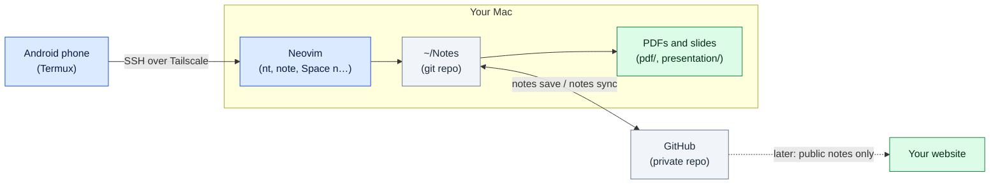

# 12. Notes: markdown, history, PDFs, and your phone

[← Neovim](11-neovim.md) · [Back to start](README.md)

Your notes are plain markdown files in a **git repo at `~/Notes`**, backed up to a **private GitHub repo**. You write them in Neovim, turn them into PDFs or slides with pandoc, read them in zathura, and can edit them from your Android phone. Later, a personal website can publish the ones you mark public.

> **Markdown**: plain text with light formatting (`# Heading`, `**bold**`, `- list`). **Front matter**: a small block at the top of a note, between two `---` lines, holding facts about the note (title, date, tags, public or not). **pandoc**: a converter that turns markdown into PDF, slides and more.

## The idea



- **Git gives you history.** Every `notes save` records a version. You can see how any note changed, and get back anything you deleted.
- **GitHub is the backup**, and later the source the website reads from.
- **PDFs are made from notes, not stored.** Git ignores them; they're rebuilt whenever you save a note.
- **Google Drive keeps your books** (`bs`) and your notes from before November 2026, as an archive.
- **Private until public.** A note goes on the website only if its front matter says `public: true`. Forgetting the flag keeps a note private, which is the safe mistake.

Why not keep the notes in Google Drive and add git there? Drive syncs git's internal files one at a time and can corrupt the history. A notes folder outside Drive, pushed to GitHub, avoids that.

## What a note looks like

```markdown
---
title: "Go channels"
author: "Youngjae Lim"
date: "2026-11-19"
tags: [go, concurrency]
public: false
---

# Go channels

Text, lists, code blocks…
See also [Go tips](tips.md). 
```

- **`public: false`** (the default `notes` writes): private. Change it to `true` when you want the note on your website.
- **Links between notes** are ordinary markdown links to the other file: `[text](other-note.md)` or `[text](../go/tips.md)`. In Neovim, start typing `[text](` and the markdown language server (marksman) suggests files; `gd` on a link opens the note it points to.
- **Images:** small ones (under about 1 MB: screenshots, diagrams) go next to the note or in `attachments/`, linked with ``. Big files (videos, large PDFs) don't belong in git. Leave them out for now; when the website exists, they'll go to Cloudflare R2 and the note will link to them.
- **Folders:** `daily/` holds daily notes (a private journal). Everything else is grouped by topic, in folders you choose (`go/`, `books/reading/`…).

## Everyday use

| In the terminal | Does |
|---|---|
| `nt` | open today's daily note (`daily/2026-11-19.md`), with a new time heading |
| `note` | create or open a note: asks for a folder and a name |
| `omn` | pick any note (fuzzy search) and open it |
| `ns` | pick a rendered PDF and open it in zathura |
| `on` | open the latest daily-note PDF |
| `bs` | pick a book from Google Drive `Books/` |
| `notes status` | what changed since your last save |
| `notes save "message"` | **save a version and push it to GitHub** (message optional) |
| `notes sync` | get changes saved from another computer |
| `notes log daily/2026-11-19.md` | every saved version of one note, with what changed |
| `notes --help` | all of the above |

| In Neovim | Does |
|---|---|
| `Space n f` | find a note |
| `Space n g` | search text inside all notes |
| `Space n r` / `Space n p` | render this note to PDF / slides now |
| `Space n h` | this note's history: pick a version, see what changed |
| `Space n c` | save all notes to GitHub (asks for a message; `Esc` cancels) |

Writing a note (`Ctrl+S`) also re-renders its PDF in the background, so the PDF is always current.

**When to save:** whenever you've finished something worth keeping, and before you stop for the day. Saving is by hand on purpose: you decide what a version is. Until you save, changes exist only on your Mac.

## First-time setup

Do this once, in order.

1. **Create the repo:**
   ```sh
   notes init
   ```
   This makes `~/Notes` with `daily/`, `attachments/`, a `.gitignore` for PDFs, and the same secret scanner (gitleaks) your dotfiles use, which checks every save for passwords and keys.

2. **Create the private GitHub repo and save the first version:**
   ```sh
   gh repo create notes --private --source ~/Notes --remote origin
   notes save "Start notes repo"
   ```
   The first command creates `github.com/<you>/notes`, **private**, and connects `~/Notes` to it. The second records everything and pushes it. Check it on GitHub: the repo should show a lock icon.

**Old notes stay in Google Drive.** The notes from before November 2026 (`Notes/src/note-….md` and `Markdown/`) weren't moved: the new repo starts fresh. They're still there to read, and the Drive copy of a note can be brought over by hand at any time: copy the file into `~/Notes`, add front matter (the example above), then `notes save`.

## Editing from your Android phone

Your phone doesn't keep its own copy of the notes. It opens a terminal **on your Mac** through Tailscale and runs Neovim there, the same as at your desk. So there's nothing to sync and nothing to conflict. The one condition is that **the Mac must be awake**.

> **SSH** (secure shell): a way to open a terminal on another computer over the network, encrypted. **Termux**: a terminal app for Android, which includes the `ssh` command. **SSH key**: a pair of files that proves who you are without a password; the private half stays on the phone.

**One-time setup:**

1. **On the Mac: turn on Remote Login.** System Settings → General → Sharing → **Remote Login** on. Under "Allow access for", choose **Only these users** and keep just yourself.
2. **Find the Mac's Tailscale name:** run `tailscale status` on the Mac. The first line shows its name (for example `macbook-air`). Your phone can reach that name whenever both are connected to Tailscale.
3. **On the phone: install Termux.** The Termux project recommends installing it from F-Droid or its GitHub releases. Open it and run:
   ```sh
   pkg update && pkg install openssh
   ssh-keygen -t ed25519            # press Enter to accept the defaults
   ssh-copy-id <you>@<mac-name>     # asks your Mac password once, then installs the key
   ```
4. **Connect:**
   ```sh
   ssh <you>@<mac-name>
   ```
   You're now in your Mac's shell. Type `nt`, `omn` or `nvim`, and `exit` when you're done. To make it one word, run `echo 'alias mac="ssh <you>@<mac-name>"' >> ~/.bashrc` in Termux once. From then on, typing `mac` connects.
5. **Recommended: turn off password logins.** Remote Login also listens on your home Wi-Fi, so once the key works, allow keys only. On the Mac:
   ```sh
   printf 'PasswordAuthentication no\nKbdInteractiveAuthentication no\n' | sudo tee /etc/ssh/sshd_config.d/100-keys-only.conf
   ```
   Then switch Remote Login off and on again to apply it. Test from Termux again before closing anything.

**Typing on the phone:** Termux shows an extra row of keys with `ESC`, `CTRL`, `TAB` and arrows, which is enough for Vim. (Caps Lock as Ctrl is a Mac thing; on the phone, use that row.)

**Keeping the Mac reachable:** a sleeping Mac can't answer. If it's a laptop, keep it plugged in and turn on System Settings → Battery → Options → **Prevent automatic sleeping on power adapter when the display is off**. With the lid closed, it stays awake while it's on power with an external display connected.

**Your agents too:** from the same SSH session, `herdr` attaches to your running agents session, the full terminal view next to what Ovis shows.

## When it breaks

- **`notes save` says the commit was refused by gitleaks:** the scanner found something that looks like a password or key. Remove it from the note and save again. Never skip the check with `--no-verify`.
- **`notes save` says "saved locally (no GitHub remote yet)":** step 5 of the first-time setup hasn't been done. The version is safe on your Mac; it goes to GitHub with your next save after the repo exists.
- **`notes sync` stops with a conflict:** the same lines changed on two computers. Open the file, keep the right text, delete the `<<<<<<<`, `=======`, `>>>>>>>` lines, then run `git -C ~/Notes add -A && git -C ~/Notes rebase --continue`. (If you only edit on this Mac, from the desk or over SSH, this can't happen.)
- **A PDF doesn't update:** `Space n r` renders it by hand and shows the error if pandoc fails. A common cause is a character the PDF font can't draw (it covers English and Korean).
- **zathura says "Found no plugins" or "Could not determine file type"** (`on`, `ns`, `bs`): a Homebrew upgrade of zathura lost the link to its PDF plugin. Run `zathura-link-plugins`. The brew bundle script and `updater` (homebrew) already do this after every change, so it should only happen after a plain `brew upgrade`.
- **`ssh` from the phone says "connection refused" or times out:** the Mac is asleep, Remote Login is off, or Tailscale isn't connected on one side.
- **"Permission denied (publickey)" from the phone:** the key isn't installed on the Mac; rerun `ssh-copy-id` (it needs password logins on for that one run, so undo step 5 temporarily if you already did it).

## Later: the website

Nothing here needs the website, and it doesn't need to be decided now. When you build it (Astro + Svelte on Cloudflare), it will:

- read this repo when it builds, and publish only notes with `public: true`;
- show private notes under `/private/…`, behind **Cloudflare Access**, which asks for your Google sign-in;
- serve big attachments from **R2**, and use **D1** for extras like search or view counts;
- load a Korean web font in small pieces, so pages stay fast.

Your notes are ready for it as they are: markdown with front matter, standard links, small images next to the notes.
