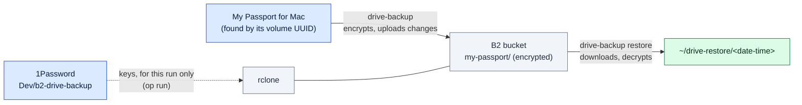

# 13. Drive backup: the external drive to Backblaze B2

[← Notes](12-notes.md) · [Back to start](README.md)

`drive-backup` copies your external drive ("My Passport for Mac") to **Backblaze B2**, encrypted, so a dead, lost or stolen drive doesn't mean lost photos. It's one command; this chapter explains what it does, the routine, how to get files back, and what to do when it complains.

> **Backblaze B2**: online storage you pay for by the amount stored. **Bucket**: one named storage area in B2. **rclone**: the command-line program that does the copying and the encryption. **Sync**: make the destination match the source, deletions included.

## The idea



- **Encrypted before it leaves your Mac:** file contents *and* names. Backblaze only ever stores unreadable data.
- **Keys never sit in a file.** They live in 1Password (item `b2-drive-backup` in the Dev vault) and exist only inside the running command, through `op run` ([chapter 7](07-secrets.md#who-can-see-a-secret-in-your-shell)). 1Password may ask for Touch ID when a run starts.
- **The drive is the source of truth.** B2 becomes a copy of whatever is on the drive at the last run, including deletions (with a 30-day undo, below).

## Commands

| Command | Does | Needs the drive? |
|---|---|---|
| `drive-backup --dry-run \| tail -20` | shows what a run *would* upload and delete; changes nothing | yes |
| `drive-backup` | the backup: uploads what's new or changed, removes what you deleted | yes |
| `drive-backup check` | compares every file on the drive with B2 (slow; leave it running) | yes |
| `drive-backup ls [folder/]` | lists what's in the backup; folders end in `/` | no |
| `drive-backup restore "<path>" [dir]` | copies a file or folder back, decrypted, into `~/drive-restore/<date-time>/` (or `dir`) | no |
| `drive-backup --help` | the list above | no |

Paths are relative to the top of the drive, as `ls` shows them; put quotes around names with spaces.

## The routine

- **The first run uploads everything**: for a big drive it takes days. Run it in a **herdr pane** so it survives closing Ghostty (detach with `Ctrl+B` then `q`). Keep the Mac on power and the drive connected. `Ctrl+C` is safe: the next run carries on where it stopped.
- **After that, run `drive-backup` whenever the drive changes**: after importing photos or scans, or about weekly if you use the drive a lot. Later runs send only what changed, so they take minutes.
- **Every few months, `drive-backup check`.** It catches silent damage on either side.
- **Anything added to the drive is only protected after the next run.**

## Getting files back

**A file or folder:**

```sh
drive-backup ls                          # find it
drive-backup ls "Photos/2019/"
drive-backup restore "Photos/2019/Trip"  # → ~/drive-restore/<date-time>/Photos/2019/Trip
```

A restore never writes onto the drive (it refuses), so it can't overwrite originals. Check what came back by opening a few files, or compare with the original: `diff -r "<restored folder>" "<original folder>" && echo identical` (RAW files make this take minutes). Delete `~/drive-restore` when you're done.

**Something you deleted from the drive** (and a backup ran since): B2 keeps deleted and replaced files for **30 days**. `restore` only sees the current backup, so getting an older version back takes an extra rclone option (`--b2-version-at <date>`) that the script doesn't offer yet; ask an agent or Claude to do it with you, soon, before the 30 days run out.

**The whole drive** (it died): `restore` deliberately refuses an empty path, so it never pulls down everything by accident. Restore the top-level folders one by one (`drive-backup restore "Photos" /Volumes/<new drive>`), checking there's room first, or ask for help.

**Test a restore now and then** (a small folder is enough). A backup is only proven by getting files back; the first one was tested on 2026-11-21 (RAW photos, identical).

## How it stays safe

- **Finds the drive by its volume UUID**, not its name. macOS sometimes mounts it as "My Passport for Mac 2"; another drive with the same name is ignored. To see the UUID: `diskutil info /Volumes/<name> | grep "Volume UUID"`.
- **Refuses to run if the drive isn't connected or is empty.** Otherwise a missing drive would look like "everything was deleted" and the sync would empty the backup.
- **`--max-delete 500`**: a run that would delete more than 500 files stops. rclone also skips all deletions if any upload failed.
- **30 days of old versions** in the bucket (a lifecycle rule set in the Backblaze dashboard) undo mistakes that did sync.
- **`caffeinate`** keeps the Mac from sleeping while it runs.

## What isn't backed up

- **Finder tags and comments** (extended attributes). File contents and modification times are. Metadata *inside* files (EXIF, XMP, IPTC) is part of the contents, so it is.
- **macOS housekeeping folders** (`.Spotlight-V100`, `.Trashes`, `.fseventsd`…) and `.DS_Store` files.
- **Anything not on the drive.** Folders you move off it are removed from the backup on the next run (with the 30-day undo).

## Setting it up again (new Mac, or starting over)

1. **Install:** `rclone` is in the Brewfile and `drive-backup` in `~/.local/bin`, so `chezmoi apply` covers both.
2. **1Password:** item `b2-drive-backup` in the **Dev** vault, with fields `key-id`, `application-key`, `bucket`, `crypt-password` and `crypt-salt`. **The crypt password and salt are the only way to read the backup**: lose them and the backup is unreadable. Keep your 1Password Emergency Kit somewhere safe, away from the Mac.
3. **Backblaze:** a private bucket; a lifecycle rule keeping old versions for 30 days; an application key limited to that bucket; and **Caps & Alerts** set high enough (storage above the drive's size, and a download cap that won't block a big restore).
4. **A different drive?** Put its volume UUID in `VOLUME_UUID` at the top of the script (`home/private_dot_local/bin/executable_drive-backup`).
5. **Start:** `drive-backup --dry-run | tail -20`, then `drive-backup`, then a test restore of a small folder.

## When it breaks

- **"the backup drive (volume …) is not connected"**: plug it in. If it is plugged in, the UUID in the script doesn't match this drive (step 4 above).
- **`storage_cap_exceeded` (403)**: the Backblaze account hit its storage cap. Raise it under Caps & Alerts (with a payment method on the account), then run `drive-backup` again; nothing was deleted.
- **`NOTICE: Config file "…/rclone.conf" not found - using defaults`**: harmless. The script deliberately uses no config file, so the keys stay out of files.
- **"too many deletes" / stopped by `--max-delete`**: more than 500 files would be removed. If you didn't mean to delete that much, stop and check the drive. If you did (you moved a big folder off), ask for help running it once with a higher limit.
- **The total keeps growing during a run**: rclone is still scanning the drive while it uploads; the real total appears when the scan ends.
- **It stopped overnight**: the Mac slept (lid closed on battery) or the drive disconnected. Run `drive-backup` again.
- **"File name too long"**: encrypted names are longer than the originals, and B2 limits a full path to 1,024 bytes. Shorten that file's folder names on the drive.
- **1Password error**: unlock 1Password and run it again.

**Cost:** B2 charges per gigabyte stored per month (check Backblaze's current price), plus downloads beyond a free allowance. Moving things you don't need backed up off the drive is the simplest way to keep it down.
