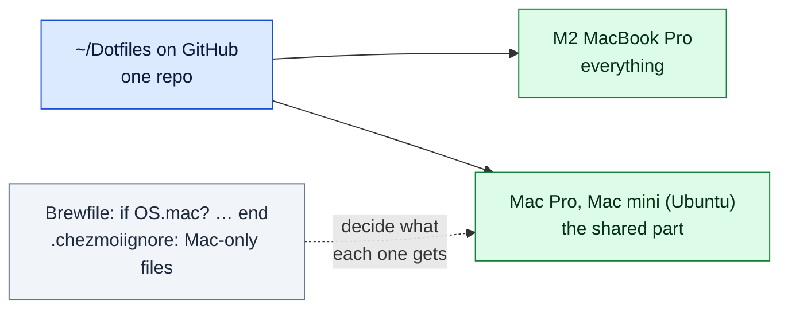

# 14. Spare Linux machines: the Mac Pro and the Mac mini

[← Drive backup](13-drive-backup.md) · [Back to start](README.md)

Your old Mac Pro and Mac mini run **Ubuntu** now and are spares (both set up on 2026-11-26): if your main computer, the M2 MacBook Pro (**the M2** in these docs), is in for repair, lost or busy, either one can carry on the work. They use **the same dotfiles**, so the shell, Neovim, mise, herdr and the agents behave the same there. What they leave out is the Mac desktop: AeroSpace, Karabiner, Hammerspoon, Ghostty's settings and the Mac apps.

> **Ubuntu**: a widely used Linux system. **apt**: Ubuntu's own installer (`sudo apt install …`), used here only for the few things Homebrew can't provide. **Homebrew on Linux**: the same `brew` you know, installed in `/home/linuxbrew/.linuxbrew`, so one Brewfile serves every machine.

## The idea



| | M2 MacBook | Spares (Ubuntu) |
|---|---|---|
| zsh, prompt, aliases, `wt`, `updater` | ✓ | ✓ |
| Neovim, mise and the language tools | ✓ | ✓ |
| herdr, Claude Code, Copilot CLI, Gemini CLI, skills, permissions | ✓ | ✓ (Copilot from its own install script) |
| git, gh, lazygit, fzf, ripgrep, lf… (the Brewfile's shared part) | ✓ | ✓ |
| `notes`, zathura | ✓ | ✓ with a desktop (zathura from apt) |
| `drive-backup` | everything | `ls` and `restore` only (the drive belongs to the M2) |
| Caps Lock: tap = Esc, hold = Ctrl, Caps+h/j/k/l = arrows | ✓ (Karabiner) | ✓ (keyd, below) |
| One keyboard and mouse (Deskflow) | ✓ shares its own | ✓ the Mac mini uses the M2's (below) |
| Workspace keys: `Alt+T`, `Alt+B`… | ✓ (AeroSpace, tiling) | ✓ (GNOME, same keys, no tiling; below) |
| AeroSpace, Karabiner, Hammerspoon, Ghostty settings, `launcher` | ✓ | — |
| Postgres, MySQL, Docker, Herd (PHP), VS Code | ✓ | — |
| Claude's "waiting on you" notifications | ✓ | — (quiet on Linux) |

The agents know where they are: their instructions say "Ubuntu Linux, a spare machine" there, and `??` answers for Ubuntu instead of macOS.

## Setting one up

On the Ubuntu machine, in a terminal (or over SSH):

```sh
sh -c "$(curl -fsLS https://raw.githubusercontent.com/youngjae-lim/dotfiles/main/install.sh)"
```

It asks for your password, then, skipping anything already there:

1. **apt:** git, zsh, compilers for Homebrew; with a desktop also zathura and clipboard tools (so Neovim's yank reaches other apps).
2. **Homebrew on Linux**, then chezmoi.
3. **1Password** from its apt repository: the command-line tool `op`, and the app too with a desktop.
4. **Tailscale**, if it's missing.
5. **Claude Code and Copilot CLI** with their own installers (they keep themselves updated).
6. **The dotfiles:** `chezmoi init --apply` asks for your name and email once, then installs the Brewfile's shared part and the mise tools. **This is the slow part**: expect half an hour or more on these older machines.
   The same apply installs the **JetBrainsMono Nerd Font**, the M2's terminal font, so icons can show.
7. **zsh** becomes your login shell.

Then, once:

1. Log out and back in (or reconnect SSH) so zsh starts.
2. Sign in to each tool: `gh auth login`, `claude`, `copilot`. (Skip `gemini`: it can't sign in with a personal Google account any more, [chapter 5](05-ai-agents.md).)
3. If the machine is new to Tailscale: `sudo tailscale up`.
4. For `drive-backup restore`: with a desktop, open 1Password and sign in, turn on **Settings → Security → Unlock using system authentication** (on Linux the next setting depends on it), then **Settings → Developer → Integrate with 1Password CLI**. `op vault list` should then ask for your Ubuntu password and show the Dev vault. Over SSH only: `op account add` once, then `eval "$(op signin)"` before using it.
5. **Terminal font**, with a desktop: open the terminal's menu (☰) → **Preferences**, turn off **Use System Font**, and pick **JetBrainsMono Nerd Font Mono**, size 11. Open a new window. Without this, Neovim's file tree and `eza` show boxes like `F4 60` instead of icons.

**Trying a branch before it's merged** (how this chapter's changes were tested): name the branch in both places.

```sh
DOTFILES_BRANCH=feat/linux-spares sh -c "$(curl -fsLS https://raw.githubusercontent.com/youngjae-lim/dotfiles/feat/linux-spares/install.sh)"
```

## Keeping them current

The M2 is where you change the dotfiles. The spares only follow:

```sh
chezmoi update     # git pull in ~/Dotfiles, then chezmoi apply
updater            # the same menu as on the M2: dotfiles, Homebrew, mise, agents…
```

Do it when you sit down at one, or every few weeks. If you ever change something *on* a spare, it's the usual routine: branch, commit (the gitleaks check runs there too), push, pull request.

## Reaching them from the M2

They're on Tailscale, so the simplest way in is **Tailscale SSH**: no SSH server to set up and no keys to manage. Use each machine's **Tailscale name** (`tailscale status` lists them): the numeric addresses change when a machine is reinstalled, the names stay if you keep the hostname.

```sh
sudo tailscale set --ssh          # once, on the spare
ssh <your-ubuntu-username>@<spare's Tailscale name>   # from the M2
```

Who may log in is set by the `ssh` section of your tailnet's access policy in the Tailscale admin console; if the connection is refused, look there. If that rule uses "check" mode, Tailscale asks you to confirm in the browser now and then. Inside, run `herdr` as usual; agents keep running when you disconnect (detach with `Ctrl+B` then `q`).

## Keyboard: Caps Lock as on the M2

**keyd**, a small system service, gives the spares the M2's most-used Karabiner keys:

| Key | Does |
|---|---|
| Tap Caps Lock | `Esc` |
| Hold Caps Lock | `Ctrl` (so `Caps+B` is still herdr's prefix, `Caps+Tab` still switches browser tabs) |
| Caps + `h` `j` `k` `l` | ← ↓ ↑ → (add Shift to select) |

One difference from the M2: there, the real `Ctrl` key plus h/j/k/l also gives arrows. Here only Caps Lock does, so ordinary `Ctrl` shortcuts (`Ctrl+L` clears the screen, `Ctrl+K`…) keep working.

It sets itself up: the first `chezmoi update` (or `install.sh`) installs keyd and copies the mapping into place, asking for your Ubuntu password once. It asks again only when the mapping changes.

**Changing it:** edit `config/keyd/default.conf` on the M2 (comments in it explain each line), commit, push, then `chezmoi update` on the spare. To try a change on a spare first: `sudo cp ~/Dotfiles/config/keyd/default.conf /etc/keyd/default.conf && sudo systemctl restart keyd`.

**Seeing what it sends:** `sudo keyd.rvaiya monitor` prints every key press after remapping (Ctrl+C to stop), like Karabiner-EventViewer on the M2. On Ubuntu the `keyd` command is called **`keyd.rvaiya`** (Debian renamed it to avoid a clash with another program); the service is still `keyd`, and web pages that say `keyd …` mean `keyd.rvaiya …` here.

**Stuck keyboard** (a bad mapping): press **Backspace + Escape + Enter** together. That stops keyd and gives you the plain keyboard back.

## One keyboard and mouse: Deskflow

The Mac mini's monitor sits to the right of the M2's, and **Deskflow** lets the M2's keyboard and mouse work on both: push the pointer off the right edge of the M2's screen and it carries on onto the mini's, with one shared clipboard. The M2 is the **server** (it shares its keyboard and mouse); the mini is the **client**.

**Installed by the dotfiles:** on the M2 from Deskflow's own Homebrew tap (Brewfile, Mac-only block); on a spare with a desktop by `install.sh`. If macOS says Deskflow "is damaged", it isn't (the app just isn't signed by Apple): `xattr -c /Applications/Deskflow.app` once.

**Setting it up (once per computer; the mini's side again after a reinstall):**

1. **M2, permissions:** System Settings → Privacy & Security → turn Deskflow on under **Accessibility** (both entries, the app and the `deskflow` process), **Input Monitoring** if it's listed, and **Local Network**. Reopen Deskflow afterwards.
2. **M2, server:** choose *use this computer's keyboard and mouse* (the server). Note the home-network address its window shows (`192.168.…`).
3. **M2, layout:** **Configure Server**, drag a new screen from the top right into the cell **right of the M2**, and double-click it: its name must match the screen name the mini's Deskflow window shows, exactly. In the same dialog, under the modifier keys, set **Super → Ctrl** (so ⌘C / ⌘V copy and paste on the mini) and leave **Ctrl** as Ctrl (your Caps Lock arrives as Ctrl). OK, then Start.
4. **Mini, client:** choose *use another computer's keyboard and mouse* (the client), enter the M2's **home-network address** as the server, and start. Allow Ubuntu's remote-input permission window (tick "remember"), and accept the M2's fingerprint the first time.
5. **Try it:** pointer off the M2's right edge, type on the mini, ⌘C / ⌘V, Caps+h/j/k/l.

**Things to know:**

- **Pointer speed comes from the M2**: Deskflow replays the M2's mouse movement, so the M2's tracking speed (System Settings → Mouse) applies on the mini's screen too. If the pointer feels slow on the mini, raise it there.
- **Use the home-network address, not Tailscale's**, for the server: Tailscale encrypts every movement and may route it through a relay.
- **The keys reach the mini**: with the pointer on the mini, `Alt+letter` goes to the mini, not to AeroSpace on the M2 (tested), so the mini uses the same workspace keys (next section).
- **Occasional stutter is the M2's Wi-Fi.** It dozes between transmissions, so replies *to* the M2 wait up to ~100 ms (measured: the mini's Wi-Fi is steady, pings to the M2 spike). An Ethernet cable on the M2 (the hub, or a USB-C adapter) removes it.

## Workspaces and keys: like AeroSpace

GNOME has no tiling like AeroSpace, but the spares get **the same workspace keys** as the M2, set by a Linux-only chezmoi script (`run_onchange_after_17-gnome-keys.sh.tmpl`). GNOME has room for twelve workspace keys, so the M2's letters become twelve fixed workspaces, in this order:

| Keys | GNOME workspace | Same as the M2 |
|---|---|---|
| `Alt+T` `Alt+C` `Alt+D` `Alt+B` `Alt+W` `Alt+R` `Alt+M` `Alt+Z` `Alt+N` | 1–9 | **T**erminal, **C**ode, **D**ata, **B**rowser, **W**ork, **R**eading, **M**essages, **Z**oom, **N**otes |
| `Alt+1` `Alt+2` `Alt+3` | 10–12 | scratch |
| `Alt+Shift+<key>` | sends the window there | ✓ |
| `Alt+Enter` | new terminal (`Ctrl+Alt+T` still works) | ✓ |
| `Alt+Shift+Enter` | full screen on/off | ✓ |
| `Alt+Shift+H` / `Alt+Shift+L` | snap the window to the left / right half | ≈ move left / right |
| `Alt+Shift+K` / `Alt+Shift+J` | maximize / restore | |
| Chrome, Firefox | open on `B` (GNOME's **Auto Move Windows** extension) | ✓ (Chrome's Work profile can't be told apart here, so it lands on `B` too: `Alt+Shift+W`) |

**What's different:** windows don't tile themselves; snap them with `Alt+Shift+H/L` instead (Ubuntu's own `Super+arrow` keys still work on a keyboard plugged into the mini, but through Deskflow ⌘ arrives as Ctrl, so the M2's keyboard has no Super key there). `Alt+H/J/K/L` focus and `Alt+Tab` back-and-forth don't exist here: `Alt+Tab` is GNOME's app switcher. To see all twelve workspaces, push the pointer into the top-left corner, or click **Activities**.

The script asks nothing (no password), and runs on the next `chezmoi apply` **at the desktop** (over SSH with nobody logged in, it waits, showing ` R .chezmoiscripts/17-gnome-keys.sh`). The first time, log out and back in once so Auto Move Windows starts.

## Notes on a spare

The `notes` command is there, but your notes aren't: clone them once with `gh repo clone notes ~/Notes`, then `notes sync` when you sit down and `notes save` before you leave ([chapter 12](12-notes.md#notes-on-an-ubuntu-spare)).

## Getting backup files back from a spare

If the M2 is gone, a spare can still read the drive backup ([chapter 13](13-drive-backup.md)):

```sh
drive-backup ls
drive-backup restore "Photos/2019"     # → ~/drive-restore/<date-time>/Photos/2019
```

`drive-backup` on its own, `--dry-run` and `check` say "backing up runs on the Mac the drive belongs to": the drive is formatted for macOS and lives with the M2. 1Password must be signed in first (step 4 above).

## Changing the dotfiles without breaking the spares

Most changes need no thought: zsh, Neovim, git and agent settings are shared on purpose. Three places decide what's Mac-only:

- **Brewfile:** Mac apps, casks and taps go **inside** the `if OS.mac?` … `end` block at the bottom. A cask outside it would break `brew bundle` on Linux.
- **`home/.chezmoiignore`:** files and folders the spares shouldn't get (AeroSpace's settings, `launcher`…). Add new Mac-only files there.
- **Templates:** `{{ if eq .chezmoi.os "darwin" }} … {{ else }} … {{ end }}` when a file needs different text on each, like the agents' instructions.

You don't have to remember to test on a spare: the GitHub check now also applies the dotfiles into an empty Ubuntu home folder, and fails if a Mac-only file shows up there or a cask escapes the `if OS.mac?` block.

## When it breaks

- **`brew: command not found` right after installing**: the shell started before Homebrew existed. Log out and back in, or run `exec zsh`.
- **Still in bash after logging back in**: `getent passwd $USER` should end in `/usr/bin/zsh`. If not: `sudo chsh -s /usr/bin/zsh $USER`.
- **`Alt+T` etc. do nothing on a spare**: check `chezmoi status`; if it shows ` R .chezmoiscripts/17-gnome-keys.sh`, run `chezmoi apply` while logged in at the desktop.
- **Browsers don't open on `B`**: `sudo apt install gnome-shell-extensions` (spares set up before it was in `install.sh`), `chezmoi apply`, then log out and in.
- **The mouse lags or stutters on the mini** (Deskflow): see "Things to know" above: the M2's pointer speed, the home-network address, and an Ethernet cable on the M2.
- **Caps Lock does nothing special** (no Esc, no arrows): check `systemctl is-active keyd` says `active`, then `sudo systemctl restart keyd` (keyd reads its mapping only when it starts). If `chezmoi status` shows ` R .chezmoiscripts/16-keyd.sh`, run `chezmoi apply` to finish the setup.
- **`sudo: 'keyd': command not found`**: on Ubuntu the command is `keyd.rvaiya`.
- **Icons show as boxes** (little squares with codes like `F4 60`, in Neovim's file tree, `eza`, `lf` or the prompt): the terminal isn't using the Nerd Font. Pick **JetBrainsMono Nerd Font Mono** in its preferences (step 5 of "Then, once"). If it isn't in the list, check `fc-list | grep -c 'JetBrainsMono NFM'` prints a number above 0; if not, run `chezmoi apply` (the font downloads then; if you were offline, `chezmoi status` shows ` R .chezmoiscripts/15-nerd-font.sh` until an apply succeeds).
- **`chezmoi apply` says `.config/git/config has changed since chezmoi last wrote it`** after `gh auth login`: gh added its login lines to your git settings. The dotfiles now contain the same lines on Linux, so after `git pull` it's safe to answer `o` (overwrite); `git push` keeps using your GitHub login. (Press `d` first to see the difference.)
- **`chezmoi status` shows `MM .claude/settings.json`**: herdr added its hook to Claude's settings after chezmoi wrote them (it does when herdr updates, too). Harmless: `chezmoi apply` settles it, and herdr's hook stays (`grep -c herdr ~/.claude/settings.json` prints 1). `install.sh` does this second apply for you.
- **`brew bundle` reported failures**: run the command it prints, `brew bundle --file="$HOME/Dotfiles/Brewfile"`, to see which package failed.
- **mise tools take ages**: some (the Go tools) are compiled on the machine. Let it finish; later updates are quicker.
- **`op`: "No accounts configured"**, or **"Integrate with 1Password CLI" isn't there**: turn on Settings → Security → "Unlock using system authentication" first (step 4 of "Then, once" above). Answer `n` if `op` offers to add an account manually; that's the SSH-only route.
- **`gemini` won't sign in** ("no longer supported for Gemini Code Assist for individuals"): not a Linux problem. Google stopped serving Gemini CLI to personal accounts in June 2026, on the Mac too; its replacement is Antigravity CLI.
- **Copilot missing after `updater`**: on Linux it comes from `curl -fsSL https://gh.io/copilot-install | bash`, which `updater` runs for you under "agent CLIs".
