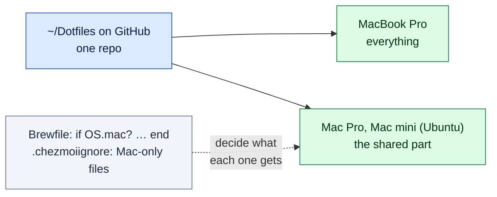

# 14. Spare Linux machines: the Mac Pro and the Mac mini

[← Drive backup](13-drive-backup.md) · [Back to start](README.md)

Your old Mac Pro and Mac mini run **Ubuntu** now and are spares: if the MacBook is in for repair, lost or busy, either one can carry on the work. They use **the same dotfiles**, so the shell, Neovim, mise, herdr and the agents behave the same there. What they leave out is the Mac desktop: AeroSpace, Karabiner, Hammerspoon, Ghostty's settings and the Mac apps.

> **Ubuntu**: a widely used Linux system. **apt**: Ubuntu's own installer (`sudo apt install …`), used here only for the few things Homebrew can't provide. **Homebrew on Linux**: the same `brew` you know, installed in `/home/linuxbrew/.linuxbrew`, so one Brewfile serves every machine.

## The idea



| | MacBook | Spares (Ubuntu) |
|---|---|---|
| zsh, prompt, aliases, `wt`, `updater` | ✓ | ✓ |
| Neovim, mise and the language tools | ✓ | ✓ |
| herdr, Claude Code, Copilot CLI, Gemini CLI, skills, permissions | ✓ | ✓ (Copilot from its own install script) |
| git, gh, lazygit, fzf, ripgrep, lf… (the Brewfile's shared part) | ✓ | ✓ |
| `notes`, zathura | ✓ | ✓ with a desktop (zathura from apt) |
| `drive-backup` | everything | `ls` and `restore` only (the drive belongs to the Mac) |
| AeroSpace, Karabiner, Hammerspoon, Ghostty settings, `launcher` | ✓ | — |
| Postgres, MySQL, Docker, Herd (PHP), VS Code | ✓ | — |
| Claude's "waiting on you" notifications | ✓ | — (quiet on Linux) |

The agents know where they are: their instructions say "Ubuntu Linux, a spare machine" there, and `??` answers for Ubuntu instead of macOS.

## Setting one up

On the Ubuntu machine, in a terminal (or over SSH):

```sh
sh -c "$(curl -fsLS https://raw.githubusercontent.com/youngjae-lim/dotfiles/main/install.sh)"
```

It asks for your password, then, skipping anything already there:

1. **apt:** git, zsh, compilers for Homebrew; with a desktop also zathura and clipboard tools (so Neovim's yank reaches other apps).
2. **Homebrew on Linux**, then chezmoi.
3. **1Password** from its apt repository: the command-line tool `op`, and the app too with a desktop.
4. **Tailscale**, if it's missing.
5. **Claude Code and Copilot CLI** with their own installers (they keep themselves updated).
6. **The dotfiles:** `chezmoi init --apply` asks for your name and email once, then installs the Brewfile's shared part and the mise tools. **This is the slow part**: expect half an hour or more on these older machines.
7. **zsh** becomes your login shell.

Then, once:

1. Log out and back in (or reconnect SSH) so zsh starts.
2. Sign in to each tool: `gh auth login`, `claude`, `copilot`, `gemini`.
3. If the machine is new to Tailscale: `sudo tailscale up`.
4. For `drive-backup restore`: with a desktop, open 1Password and sign in, turn on **Settings → Security → Unlock using system authentication** (on Linux the next setting depends on it), then **Settings → Developer → Integrate with 1Password CLI**. `op vault list` should then ask for your Ubuntu password and show the Dev vault. Over SSH only: `op account add` once, then `eval "$(op signin)"` before using it.

**Trying a branch before it's merged** (how this chapter's changes were tested): name the branch in both places.

```sh
DOTFILES_BRANCH=feat/linux-spares sh -c "$(curl -fsLS https://raw.githubusercontent.com/youngjae-lim/dotfiles/feat/linux-spares/install.sh)"
```

## Keeping them current

The MacBook is where you change the dotfiles. The spares only follow:

```sh
chezmoi update     # git pull in ~/Dotfiles, then chezmoi apply
updater            # the same menu as on the Mac: dotfiles, Homebrew, mise, agents…
```

Do it when you sit down at one, or every few weeks. If you ever change something *on* a spare, it's the usual routine: branch, commit (the gitleaks check runs there too), push, pull request.

## Reaching them from the MacBook

They're on Tailscale (the Mac Pro is `100.70.94.76`), so the simplest way in is **Tailscale SSH**: no SSH server to set up and no keys to manage.

```sh
sudo tailscale set --ssh          # once, on the spare
ssh <your-ubuntu-username>@<spare's Tailscale name>   # from the MacBook
```

Who may log in is set by the `ssh` section of your tailnet's access policy in the Tailscale admin console; if the connection is refused, look there. If that rule uses "check" mode, Tailscale asks you to confirm in the browser now and then. Inside, run `herdr` as usual; agents keep running when you disconnect (detach with `Ctrl+B` then `q`).

## Getting backup files back from a spare

If the MacBook is gone, a spare can still read the drive backup ([chapter 13](13-drive-backup.md)):

```sh
drive-backup ls
drive-backup restore "Photos/2019"     # → ~/drive-restore/<date-time>/Photos/2019
```

`drive-backup` on its own, `--dry-run` and `check` say "backing up runs on the Mac the drive belongs to": the drive is formatted for macOS and lives with the MacBook. 1Password must be signed in first (step 4 above).

## Changing the dotfiles without breaking the spares

Most changes need no thought: zsh, Neovim, git and agent settings are shared on purpose. Three places decide what's Mac-only:

- **Brewfile:** Mac apps, casks and taps go **inside** the `if OS.mac?` … `end` block at the bottom. A cask outside it would break `brew bundle` on Linux.
- **`home/.chezmoiignore`:** files and folders the spares shouldn't get (AeroSpace's settings, `launcher`…). Add new Mac-only files there.
- **Templates:** `{{ if eq .chezmoi.os "darwin" }} … {{ else }} … {{ end }}` when a file needs different text on each, like the agents' instructions.

You don't have to remember to test on a spare: the GitHub check now also applies the dotfiles into an empty Ubuntu home folder, and fails if a Mac-only file shows up there or a cask escapes the `if OS.mac?` block.

## When it breaks

- **`brew: command not found` right after installing**: the shell started before Homebrew existed. Log out and back in, or run `exec zsh`.
- **Still in bash after logging back in**: `getent passwd $USER` should end in `/usr/bin/zsh`. If not: `sudo chsh -s /usr/bin/zsh $USER`.
- **Icons show as boxes** (in `eza`, `lf`, the prompt): the terminal's font has no icons. Install a Nerd Font (for example JetBrainsMono Nerd Font) and pick it in the terminal's settings.
- **`chezmoi apply` says `.config/git/config has changed since chezmoi last wrote it`** after `gh auth login`: gh added its login lines to your git settings. The dotfiles now contain the same lines on Linux, so after `git pull` it's safe to answer `o` (overwrite); `git push` keeps using your GitHub login. (Press `d` first to see the difference.)
- **`chezmoi status` shows `MM .claude/settings.json`**: herdr added its hook to Claude's settings after chezmoi wrote them (it does when herdr updates, too). Harmless: `chezmoi apply` settles it, and herdr's hook stays (`grep -c herdr ~/.claude/settings.json` prints 1). `install.sh` does this second apply for you.
- **`brew bundle` reported failures**: run the command it prints, `brew bundle --file="$HOME/Dotfiles/Brewfile"`, to see which package failed.
- **mise tools take ages**: some (the Go tools) are compiled on the machine. Let it finish; later updates are quicker.
- **`op`: "No accounts configured"**, or **"Integrate with 1Password CLI" isn't there**: turn on Settings → Security → "Unlock using system authentication" first (step 4 of "Then, once" above). Answer `n` if `op` offers to add an account manually; that's the SSH-only route.
- **`gemini` won't sign in** ("no longer supported for Gemini Code Assist for individuals"): not a Linux problem. Google stopped serving Gemini CLI to personal accounts in June 2026, on the Mac too; its replacement is Antigravity CLI.
- **Copilot missing after `updater`**: on Linux it comes from `curl -fsSL https://gh.io/copilot-install | bash`, which `updater` runs for you under "agent CLIs".
