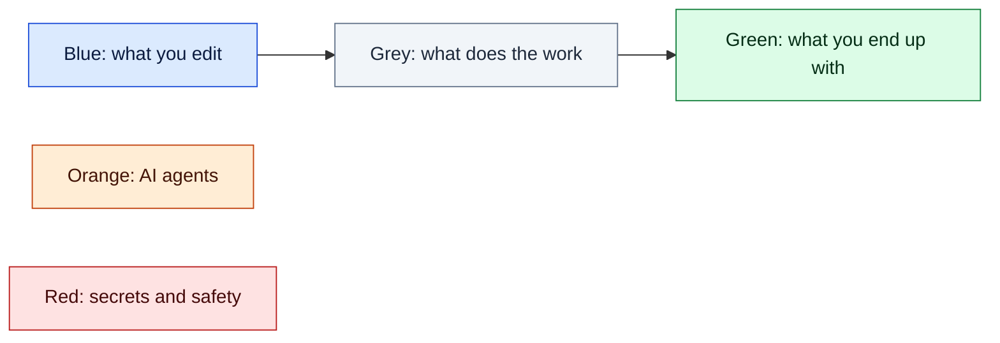

# Start here: a guide to these dotfiles

This folder explains every part of this setup, from zero. You don't need to know chezmoi, git worktrees, AI agents or any other tool here before you start. Every unfamiliar word is explained the first time it appears, and all of them are collected in the [glossary](glossary.md).

> **Dotfiles** are the settings files for your command-line tools. They're called that because their names start with a dot (`.zshrc`, `.gitconfig`), which hides them in Finder and in `ls`. "My dotfiles" usually means a git repository that holds all of them, so you can keep a history and set up a new computer quickly.

## Reading order

Read chapters 1 and 2 first; they explain the idea everything else rests on. After that, read whatever you need, in any order.

| # | Chapter | You'll learn | Time |
|---|---|---|---|
| 1 | [The big picture](01-big-picture.md) | What each tool does, and the one idea that makes the rest make sense | 10 min |
| 2 | [chezmoi basics](02-chezmoi-basics.md) | How a change in `~/Dotfiles` reaches your Mac, and the everyday routine | 20 min |
| 3 | [How files are made](03-how-files-are-made.md) | Templates, generated files and scripts: the parts that look like magic | 20 min |
| 4 | [The terminal: Ghostty, herdr, zsh](04-terminal.md) | The window, the sessions that keep running, and your shell | 20 min |
| 5 | [AI agents](05-ai-agents.md) | Claude, Copilot and Gemini: what they share, what they may do, and how that's kept safe | 25 min |
| 6 | [Git worktrees and `wt`](06-worktrees.md) | Running several agents at once without them getting in each other's way | 15 min |
| 7 | [Secrets](07-secrets.md) | Where passwords and tokens live, and how they stay out of git | 10 min |
| 8 | [Languages and small tools](08-languages-and-tools.md) | mise for node/python/go, and the helpers that make life easier | 15 min |
| 9 | [Windows, keyboard and phone](09-desktop.md) | AeroSpace tiling, Karabiner, Hammerspoon, and approving agents from your phone | 15 min |
| 10 | [A day with this setup](10-daily-workflow.md) | How it all fits together, a four-week plan, and what to do when stuck | 10 min |
| 11 | [Neovim: the lean config](11-neovim.md) | What's in your editor config, why, and how to change it yourself | 20 min |
| 12 | [Notes](12-notes.md) | Markdown notes in git: history, PDFs, editing from your phone, and the website later | 15 min |

Also here:
- [Glossary](glossary.md): every term, in plain words.
- [Cheat sheet](cheatsheet.md): one page of keys and commands to keep open.

## How each chapter is laid out

Each tool gets the same parts, so you know where to look:

- **What it is**: one paragraph, plain words.
- **Why you have it**: the problem it solves for you.
- **The 20% you'll use**: the only commands worth memorizing.
- **Try it**: a short exercise. Doing it once makes it stick.
- **When it breaks**: the fixes you'll actually need.

## About the diagrams

The diagrams are written in [Mermaid](glossary.md#mermaid), which GitHub draws as pictures. They use the same colours everywhere:

If you're reading this somewhere that doesn't draw Mermaid, open the file on GitHub.

## Keeping these docs current

When you change a workflow, a key binding or a command, update the chapter that describes it in the same commit. AI agents working in this repo are told to do the same (see [`AGENTS.md`](../AGENTS.md)).
